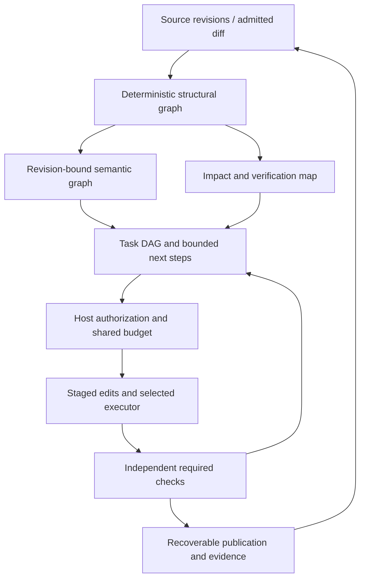

# Atomic-flow: пошаговый roadmap до production и конкурентного coding-агента

Дата: 24 октября 2026. Статус: **план реализации, этапы P00–P14 OPEN**.
Создан по запросу владельца: механизм Understand-Anything → обновления по diff →
подзадачи/следующие шаги → автономность на имеющихся тестах → скорость и
эффективность при сохранении безопасности и качества → продукт и отличие.

Дополнено после повторной сверки двух критических разборов:
[CORE_CRITIQUE_RECHECK_2026-10-24.md](CORE_CRITIQUE_RECHECK_2026-10-24.md).
Корпоративное ядро выделено в [ENTERPRISE_CORE_PLAN.md](ENTERPRISE_CORE_PLAN.md),
E00–E08 OPEN: core/adapters, evidence, retrieval uncertainty, identity/policy,
durable API tasks, data isolation, central budgets, operations и corporate RC.
Эти gates принимаются headless через SDK/API, без зависимости от P13 UI.

Заменяет roadmap 16 октября; прежний текст сохранён побайтно в
[PRODUCTION_ROADMAP_2026-10-16.md](PRODUCTION_ROADMAP_2026-10-16.md).

## 1. Исходная точка и смысл цели

Исходный HEAD: `5cf4068505cf5d020c1762254b7e23992405a415`, ветка experimental.
Runtime matches CI-tested `0dbd5938958074eae4ff73f6424f06425a525909`.
Сохранённые результаты: 1021 passed / 14 skipped, 12 installed-wheel combinations,
3 real LSP/MCP composition scenarios со scripted model. Это historical evidence
конкретных исходников, а не новый тестовый прогон этого roadmap.
Live edit pilot на одной раскрытой SymPy задаче не получил принятого исправления.

Цель — агент, который в заявленном scope самостоятельно понимает repository,
строит и адаптирует план, меняет код, проверяет результат, восстанавливается после
сбоя и предъявляет проверяемый diff с evidence и полной стоимостью.
«Уровень Cursor/Devin/Claude Code» разбивается на capabilities, operating reliability
и measured task utility. Наличие похожих tools не означает равное качество.
Каждый конкурентный claim требует собственного сравнения на одной дате и workload.

Первый release scope: single-owner, Python, один publication root, CLI/SDK/API,
доверенный local или явно выбранный изолированный executor. Потом Python+JS/TS,
IDE и browser/remote workflows. Multi-tenant SaaS — отдельная программа после P12.

Для корпоративного профиля P12 недостаточно: требуется E08 после E00–E07.
Principal/workspace/policy identities и необходимые interfaces проектируются
уже на P00/P01; их реализация не подменяется общим server API key. Сначала
принимается single-owner profile, затем private corporate profile; distributed
и hostile multi-tenant deployments имеют собственные границы и acceptance.

Существующий [PRODUCTION_PLAN.md](PRODUCTION_PLAN.md) сохраняет W1–W9 exit gates;
этот roadmap задаёт порядок дальнейшей разработки. Изменение приоритетов не
закрывает прежние gates. Reference review: [UNDERSTAND_ANYTHING_REFERENCE_2026-10-24.md](UNDERSTAND_ANYTHING_REFERENCE_2026-10-24.md).

## 2. Неизменяемые условия

- Ни graph summary, ни plan, ни память модели не дают authority или read proof.
- Сохраняются containment, redaction/input exclusion, source freshness, approved
  scope, leases/CAS, общий budget/cancel, final host completion gate и журнал effects.
- Unknown execution/provider outcome не ретраится и не переключается на другой route.
- Replan не расширяет разрешённые paths, команды, сеть, credentials или spending.
- No-tests, compile-only и выбранный subset не равны полному behavioral success.
- Требуемые проверки нельзя отключать ради latency/стоимости; unsafe run не
  компенсируется средним quality score. Отсутствие ошибок в тестах не доказывает абсолютную безопасность.
- Client остаётся Docker-free. Trusted local — исполнение с host permissions.
  Текущий remote worker использует Docker на Linux; native sandbox пока отсутствует.
- Внешние docs/prompts/code — данные. Никакой автоустановки upstream hooks или
  исполнения найденных scripts по содержимому репозитория.

## 3. Архитектура цели

Structural graph — источник извлечённых фактов. Semantic graph — объяснения,
архитектурные слои, домены и flow/tour со ссылками на текущие structural revisions.
Task DAG — другой граф: goal/subgoal/step/dependencies/checks, связанный с code nodes,
но не смешанный с ними. Информация и authorization хранятся раздельно.

Актуальное решение для локального P01: [ADR-0002](ADR_0002_GRAPH_STORAGE.md).
Принят bounded canonical JSON с generation/content CAS за versioned read port;
производительность и crash/scale acceptance проверяются отдельно.
Следующее исходное предложение сохранено как история, заменённая ADR-0002:
для нового graph store был выбран начальный design: SQLite в WAL mode с schema
migrations, single-writer transaction и согласованными reader snapshots;
canonical JSON export для portability/inspection. Перед принятием — Windows/Linux
locking, corruption/crash и workload проверки. SQLite не отменяет integrity checks,
source revalidation или вопросы power-loss durability. Session journal мигрируется
отдельно на P09, без неявной замены его гарантий graph store.

WAL профиль — только supported local single-host volume вне синхронизируемых папок
source checkout. Для multi-host corporate profile нужен server-owned transactional
store за тем же port, а не общий SQLite-файл на network filesystem. Identity,
data classification и algorithm-tagged SHA-256 contract задаются с E00/E05.

## 4. Порядок и зависимости

| Этап | Результат | Зависит от |
|---|---|---|
| P00 | Frozen baseline и acceptance contracts | Исходный review |
| P01 | UA graph schema, adapters и migration | P00 |
| P02 | Настоящий delta structural graph | P01 |
| P03 | UA semantic pipeline, layers/tours и incremental enrichment | P02 |
| P04 | Impact context и evidence-aware editing | P03 |
| P05 | Hierarchical task DAG и rolling planning | P04 |
| P06 | Bounded autonomous execution/replan | P05 |
| P07 | Проверенная автономность и utility на corpus | P06 |
| P08 | End-to-end performance и efficiency | P07 |
| P09 | Long sessions, crash/operations acceptance | P08 |
| P10 | Принятый isolated worker и live provider routes | P09 |
| P11 | Reproducible release и consumer rehearsal | P10 |
| P12 | Python production RC и ограниченная beta | P11 |
| P13 | IDE/browser/JS-TS и широкая capability parity | P12 |
| P14 | Подтверждённое отличие и competitive acceptance | P13 |

P00 уже собирает latency/cost baseline; глубокая оптимизация начинается после
quality acceptance. Калибровка окружений может идти заранее как независимая работа,
но каждый этап принимается в указанном порядке. Даты не назначаются до измерения
P00 и первой вертикали; оценки обновляются по фактической пропускной способности.

Обязательная execution-зависимость: перед P07, когда запускаются tests/setup
внешнего непроверенного проекта, должен быть принят isolated executor из P10
в нужном scope. P10 затем закрывает полный deployment/consumer/live-route gate.
Scripted host tests без untrusted project execution этой зависимости не требуют.

### Четыре открытых production-блока: явная трассировка

| Блок | Этапы roadmap | Дополнительные corporate-core gates |
|---|---|---|
| Качество: 29 calibrations, matched baseline/atomic | P00/P04/P07 | E01 evidence/verdicts, E02 retrieval/completeness |
| Масштаб: p95/RSS/soak, quadratic journal append | P08/P09 | E04 queue/fairness, E07 operational envelope |
| Release: locks/SBOM/provenance/consumer | P11 | E00 slim packaging, E06 extension compatibility, E08 corporate consumer |
| Production acceptance: isolated worker/crash/OS/review | P09–P12; execution prerequisite до P07 | E03 authority, E05 data boundaries, E07/E08 corporate acceptance |

Ни новый graph, ни task DAG не закрывают эти блоки сами по себе. Corporate-core
приёмка добавляет отдельные критерии, не переименовывает single-owner CI в enterprise.

## P00. Заморозить baseline и приёмку

1. Зафиксировать source/config/model/provider, environment/dependencies, execution
   mode, лимиты и dataset IDs. Historical pilot сохранить как development-only.
2. Составить coverage map существующих tests и W1–W9; выделить regression suites
   по source integrity, safety, spending, recovery, task completion и integrations.
3. Снять начальные latency/RSS/disk/call/token/cost показатели без заявления SLO.
4. Создать manifest приёмки: phase, source SHA, dirty state, config digest,
   environment identity, commands, exit codes, artifacts/hashes, failures/skips,
   unresolved issues, decision и reviewer. В отчёте отделять local/CI/live/consumer.
5. Зафиксировать первичную гипотезу и budgets будущего comparison до holdout.

Дополнение E00/E01: dependency/claims inventory, typed principal/resource identities,
VerificationReport contract, no-backticks/not_assessed semantics и omissions model
проектируются до расширения autonomous runtime. Сначала исправляются подтверждённые
false-assurance signals; исторические grades/failed attempts не переписываются.

Зоны: `tests/`, `tools/evaluation_*`, `tools/audit_live_pilot.py`, validation manifests.
Выход: воспроизводимая baseline card и machine-readable acceptance registry.
Принятие: повторный offline evidence audit не меняет исходные bytes, пропуски
и неизвестные charges явно сохранены. Никаких новых платных calls для P00.

## P01. Контракт графа Understand-Anything и adapters

1. Сделать mapping UA file/function/class/module, config/document/pipeline,
   typed edges, summaries/tags/layers/tour на новую версионированную schema.
2. Разделить extracted/inferred/runtime-observed facts; хранить extractor/model
   version, source digest, evidence spans, confidence/unknown, status fresh/stale.
3. Определить identity: project/root/path + qualified symbol/kind; line numbers
   только координаты revision. Rename/move задаёт mapping старого/нового ID;
   неоднозначные совпадения не склеиваются автоматически.
4. Реализовать GraphStore transaction/API и Python AST adapter. Привести нынешние
   tree/search tools к совместимому read interface; оставить export старого вида
   на период миграции. Stale cache не наследует старые approvals/read evidence.
5. Оформить ADR reuse/port/adapter, pinned UA commit и attribution при reuse.
   Нужна совместимость выбранных UA операций, не слепой перенос всего TS проекта.

Зоны: `tree/node.py`, `tree/builder.py`, новый graph package/store/adapters.
Выход: schema/API specification, migration/export и fixtures.
Принятие: old-tree → new-store → canonical export сохраняет поддерживаемые facts;
дубликаты, dangling IDs, parser failure и unsupported kinds явно отражены.
Graph review выполняет schema/integrity validation обычным кодом.

## P02. Delta updates без полного rebuild на обычной правке

1. Ввести ChangeSetDelta: added/modified/deleted/moved, base revision, before/after
   digests и expected store generation. Host edit создаёт delta прямо из операции.
2. Для внешних изменений объединить Git diff, staged/unstaged/untracked и watcher.
   Git paths читать NUL-delimited; поддержать non-Git roots. Events — только hints.
3. Парсить изменённый файл/допустимую parser область. Начать с file-level reparse:
   это корректный delta index; sub-file parser incrementality — отдельная оптимизация.
4. Хранить обратные индексы imports/exports/raw reference names/call targets,
   включая unresolved references. Изменение definitions/import aliases обновляет
   callers/importers и ранее unresolved consumers, а не только соседей старого графа.
5. Сопоставить старые/новые nodes; заменить owned edges; пересчитать affected
   closure до fixpoint. Удаление/re-export/wildcard/ambiguous lookup обрабатываются
   консервативно. Никогда не оставлять старую связь только из-за reused AST.
6. Обновлять fan-in/out, lexical postings и локальные retrieval caches по delta.
   Глобальные алгоритмы, например точный PageRank, имеют отдельную invalidation;
   приближение нельзя выдавать за точный пересчёт. Оно принимается только по P08 quality.
7. Atomic graph transaction: проверить base/source generation, применить nodes,
   edges/tombstones/indexes, затем продвинуть revision. При conflict отказаться
   от commit; при отмене/ошибке виден старый согласованный snapshot.
8. Staged graph — overlay поверх baseline. После publish переносить проверенный
   delta при совпадении исходных bytes/generation; published index обязан
   соответствовать опубликованному source. Проверку нельзя убрать ради одного rebuild.
9. Fallback scan/rebuild только с причиной: missing/corrupt cache, schema/parser/
   resolver/ignore change, watcher overflow, branch switch или неизвестный drift.

Важно: для произвольных внешних writers невозможно гарантировать свежесть только
списком событий без reconciliation. Full content audit остаётся на trust/recovery
boundaries; ordinary owned-edit fast path не читает весь проект. Same-size/mtime
не являются доказательством неизменности. Чтение/запись проверяет content hash.

Зоны: `tree/builder.py::_link/build_tree/refresh_tree`, `references.py`,
`watching.py`, `activation/activate.py`, changeset publication.
Выход: delta API, dependency indexes, instrumentation и old-cache migration.
Принятие: canonical structural graph после последовательности delta равен clean
build на тех же source bytes. Случаи: body-only/same-line edits, nested same-name
symbols, new target для unresolved ref, alias/re-export, delete/move, branch switch,
ignore/config change, dropped events, concurrent generation, cancelled/crashed update.
На локальном private-body edit вне closure нет AST parse/LLM calls/global relink;
числа scanned/read/parsed/relinked/reused/invalidated отражаются в отчёте.
Широкая API/config правка может корректно затронуть весь dependency closure.

## P03. Semantic graph и UA operations

1. Реализовать scanner/file analysis/assembly/architecture/tour/reviewer pipeline
   над P02 store, с единым budget/cancel. Детерминированная структура создаётся кодом;
   LLM получает admitted source и structural facts для объяснений/слоёв/доменных связей.
2. Добавить summaries/tags, architecture layers, entry points, guided tours;
   затем доменные flows. Объяснение и шаг tour всегда ссылаются на source/node revision.
3. Разделить hashes: bytes, executable body AST, API/imports, docs, call/reference
   facts, resolver config. Любая body правка инвалидирует поведенческое summary.
4. Перегенерировать только invalid semantic nodes и зависимые layer/tour fragments.
   Полный architecture refresh — явная операция по измеренной причине; при нехватке
   budget оставить stale/unknown, не возвращать старое как актуальное.
5. Cache key включает source dependencies, extractor/prompt/model/config version,
   язык ответа и project scope. Не переносить cache между приватными проектами.
6. Реализовать graph inspect/search/explain/chat/impact/tour в CLI/SDK/MCP.
   Graph chat пользуется нынешними source tools и citation rules. Domain/semantic
   links не заменяют доказательства exact read перед edit.
7. Валидатор surviving symbols не допускает тихой потери методов/short functions;
   graph review сообщает omitted/unsupported files, unresolved и dangling references.

Зоны: новый graph semantic pipeline, `backends/`, `llm/`, `integrations/mcp.py`.
Выход: walkthrough собственного проекта и pinned внешнего repo, delta report.
Принятие: один body edit обновляет затронутое summary; comments/docstrings обновляют
документальное описание; одинаковый cache key не вызывает повторный semantic call.
Структура детерминирована. Для LLM текста проверяются evidence/coverage/freshness,
а не побайтовое совпадение двух генераций. Partial failure не публикует смесь revisions.

## P04. Использовать понимание в editing loop

1. Формировать context pack: goal → relevant layers/nodes → current source →
   callers/importers → tests/config. Сохранять причины включения и byte/token caps.
2. Исправить класс текущего pilot failure: явные continuation cursors/truncation,
   чтение точного участка перед patch; incomplete old_text и placeholders не исполняются.
3. Добавить version-bound range/symbol edit с host validation как удобный интерфейс;
   conflict требует перечитать источник, автоматическое ослабление preconditions запрещено.
4. Связать diff с потенциальным impact и tests. Статический tested_by — рекомендация;
   runtime coverage имеет environment/source identity и тоже ограниченную полноту.
5. Выбирать быстрые targeted checks в loop; обязательный final regression gate
   остаётся. Unknown impact расширяет проверку, а не разрешает её пропустить.

E01/E02 добавляют обязательные coverage/omission reports, source-span/quote checks,
not_assessed при отсутствии проверяемых identifiers и отдельный статус model critique.
Hybrid dense retrieval — заменяемый кандидат после сравнения с lexical+graph+UA;
mandatory neural encoder без evidence не добавляется. Graph unresolved/dynamic
relations и weak fallback не считаются доказанным отсутствием зависимости/ответа.

Зоны: `agents/context.py`, `tools/read_*`, `tools/file_ops.py`, `edit_node.py`,
`activation/`, `completion.py`, diagnostic/evaluation tools.
Выход: trace «почему прочитан файл / что изменилось / какие проверки обязательны».
Принятие: многошаговая правка со сдвигом строк, неверным old_text, сменой source и
неполным context не приводит к stale edit/false done; read proof не берётся из summary.

## P05. Иерархические подзадачи и планирование следующих шагов

25 октября: **functional core ACCEPTED** на `91d22e2`, exact-source CI и source
evidence в [package 39](IMPLEMENTATION_STEP_39_P05_ACCEPTANCE.md). Ready — derived
state, succeeded отображается как done после host checks, semantic criteria
остаются not_assessed до независимого evaluator. Rolling expansion ограничена
host proposal/review; автоматическое расширение authority не разрешено.

1. Развить существующие Plan/Step/depends_on, не строить второй scheduler рядом.
   Ввести stable task/subtask IDs, parent_goal, acceptance criteria, dependencies,
   linked code/test nodes, scope, estimates/caps, evidence и explicit state.
2. States: pending/ready/running/blocked/succeeded/failed/cancelled/superseded;
   migration сохраняет старые task records и не повышает права legacy state.
3. Декомпозиция: objective → проверяемые subgoals → исполнимые шаги. Ограничить
   depth/node count/expansions; cycle и невалидные dependencies отвергаются host.
4. Rolling horizon: держать проверяемый общий план и детализацию ближайших 1–3 шагов.
   После результата/теста/diff обновлять следующий frontier и план проверки.
   Чтение/research могут быть шагами с evidence outcome, не фиктивными code changes.
5. Планировщик получает текущие graph/source revisions, known failures,
   выполненные effects, оставшийся budget и acceptance criteria пользователя.
6. Повторное выполнение succeeded шага разрешается только при явной invalidation
   его предпосылок; external effects никогда не переигрываются автоматически.

Зоны: `agents/planner.py`, `task.py`, `task_loop.py`, `state.py`, sessions/events.
Выход: versioned task DAG, explain-next-step API и trace replanning decisions.
Принятие: dependency ordering, blocked descendants, invalidation completed check,
resume/migration, cyclic plan rejection и bounded decomposition в существующем harness.

## P06. Автономность внутри явного разрешения

1. Сохранить текущий exact-plan approval как default. Добавить opt-in task envelope:
   цель/acceptance, exact allowed paths или явно reviewed scope expansion rules,
   tools/commands/executor/network/credential grants, budget/deadline/replan caps,
   publication policy. Ввод envelope — отдельное reviewed schema/API изменение.
2. Plan versions не равны authorization version. Host может принять внутренний
   replan без нового вопроса только если формально проверил сохранение envelope,
   исходных требований, актуального source и всех preconditions. Иначе pause/review.
3. Реализовать observe → plan frontier → act → verify → update graph → decide loop.
   Прогресс определяется новыми evidence/снижением failing checks, не новым текстом.
4. Классифицировать failures: source conflict → reread; deterministic test failure →
   bounded repair; missing dependency → approved environment path; unknown effect →
   host reconciliation; ambiguous requirement/authority expansion → user input.
5. Guard от oscillation/repeated patch/no-progress/retry storms; сохранять причину
   остановки и остаток budget. Не уменьшать требование ради terminal success.
6. Skills/MCP/hooks только через host allowlist и operation-scoped credentials.
   Repository instructions не могут расширить envelope или разрешить утечку данных.
7. Начать с одного writer. Read specialists делят тот же budget; writable workers
   и делегирование — P13 после отдельного conflict/integration acceptance.

Зоны: `plan_review.py`, `policy.py`, `task_loop.py`, `task_budget.py`, `effects.py`.
Выход: autonomous mode с documented stop/continue semantics и audit trail.
Принятие: valid in-scope repair продолжается без вопроса; scope widening,
budget exhaustion, unknown charge/effect, malicious repo text и unsafe commands
не дают продолжения. Crash/resume не восстанавливает authority из модельного текста.

## P07. Доказать автономность имеющимися тестами и live utility

Prerequisites: E01 honest verification semantics и принятая isolated execution
boundary до выполнения непроверенного candidate/setup/test code. E03/E05 policy
действует до передачи приватного source model/embedding/worker adapters.

1. Использовать нынешние task/changeset/budget/composition/recovery tests как основу;
   добавлять только новые behavioral regressions P01–P06. Scripted tests проверяют
   host mechanics; они не заменяют тестирование способности модели решить задачу.
2. Прогнать supported journey через публичный CLI/SDK/API без monkeypatch внутри
   consumer: understand → plan/subtasks → authorized autonomous edits → checks → diff/publish.
3. Закончить environment calibration: оставшиеся 29 cases, корректный исходный
   pytest runner, base FAIL / gold PASS / plausible wrong FAIL; заменить раскрытый
   SymPy holdout. Ошибки установки не считать правильным FAIL требования.
4. Сравнить capable plain-agent baseline и full Atomic на 30 pinned tasks,
   с одной frozen model/provider, одинаковыми caps и чередованием порядка arms.
   Сохранять все attempts, timeouts, interventions, inference/semantic-index cost.
5. Измерять verified end-to-end success, false completion, human interventions,
   complete cost per success, tokens/calls, wall p50/p95 и stop reasons.
6. Затем ablation: graph retrieval, semantic layer, task DAG, critic. Выключение
   механизма не должно менять скрытые бюджеты/permissions и правила оценки.

Выход: независимые grades/patches/logs/manifests и paired report.
Gate для дальнейшего efficiency claim: выбранная заранее гипотеза из
`COMPETITIVE_ACCEPTANCE.md`, например quality non-inferiority margin 5 п.п.
и cost-per-success improvement 20%. Это предложенные engineering targets,
не достигнутые результаты и не отраслевой стандарт. 30 задач — exploratory:
неопределённый interval не считается PASS. Для подтверждения — новый holdout и
расчёт объёма по paired discordance; безопасность принимается отдельным gate.
Live provider calls выполняются только с разрешёнными routes и явным run budget;
этот roadmap не расходует quota и не меняет account authorization.

## P08. Скорость и эффективность после quality gate

1. Профилировать полный цикл на pinned small/medium/large Python repos: startup,
   scan/hash/parse/link/retrieval, semantic enrichment, snapshot, model wait,
   tools/checks, publish; отдельно cold/warm и реальные external edits.
2. Устранить измеренные повторы индекса/context/copy; использовать P02 overlay/delta.
   Model calls batching/cache/native tools вводить по одному с cost/quality ablation.
3. Запланировать background enrichment без гонки с active edits. Reader snapshots
   version-bound; cancelled/obsolete generation не публикуется.
4. Сначала bounded parallel reads/checks, потом model specialists при доказанной
   пользе. Shared accounting/cancel и resource backpressure обязательны.
5. Тесты после каждого шага выбирать по impact; полный required gate остаётся.
   Test result cache включает source closure, test/config/dependency/env versions.
6. Замерять минимум пять повторений для smoke, для p95/soak накапливать достаточно
   samples и публиковать N/dispersion. Пять прогонов не дают устойчивого p95.

Provisional targets, замораживаемые после P00 до оптимизации: warm local one-file
delta p95 ≤20% clean rebuild p95 на выбранном medium repo; no-change semantic
calls = 0; для локального edit LLM work ограничен invalidated closure; полный
cost per verified success ниже baseline при принятом quality margin. Абсолютные
latency/RSS/disk лимиты выводятся из измерений, не из размера Markdown-плана.
Выход: performance report, supported workload envelope и quality/safety recheck.

## P09. Длинные сессии и эксплуатационная надёжность

1. Устранить quadratic journal prefix reread через отдельный reviewed design:
   transactional event store/segments, integrity checkpoints и recovery validation.
   Не заменять проверку старых bytes stat-only cache. Для arbitrary tampering
   нужен явный threat model; hash chain без доверенного anchor не является attestation.
2. Миграция journal сохраняет seq/call IDs, completed/unknown effects, исходную
   day/account identity и refusal автоматического replay. Legacy остаётся читаемым.
3. Failure injection между persistence boundaries: process kill, truncated write,
   permission denied/disk full, corrupted cache, lease loss, worker disconnect,
   cancel during scan/check/publish, concurrent cooperating writers.
4. Опубликовать Windows/Linux/macOS acceptance matrix: где install-only, где
   настоящий multiprocess/lifecycle/execution test. Не смешивать эти доказательства.
5. Добавить metrics и run diagnostics: phase latency, queue/RSS/disk, retry/hold,
   cancel latency, task health. Logs/archives редактируются и не содержат secrets.
6. Retention/cleanup/export/backup-restore и operator reconciliation runbook.
   Проверить длинную задачу с ротацией artifacts, compaction и resume.

Выход: soak/fault report и эксплуатационные инструкции.
Принятие: отсутствие false done/двойной публикации/replay в заявленной матрице;
неопределённый исход остаётся hold. Power-loss durability заявляется только при
отдельном подходящем испытании и filesystem model, не по process-kill pytest.

## P10. Реальный isolated worker и provider acceptance

1. Развернуть один supported Linux Docker worker с pinned image digest,
   filesystem/network/resource policy, environment manifest и consumer verification.
   На клиенте Docker не требуется. Никакого silent trusted-local fallback.
2. Проверить upload/admission/start/cancel/status/download/reconcile, identity
   request/container/artifacts; disconnect after submit не вызывает повторного start.
3. Отделить host/job lifecycle от sandbox guarantees; проверить boundary исполнения,
   credential grants/egress и evaluator observation contract на заявленном threat model.
4. Выполнить bounded live smoke разрешённых providers: actual usage/cost,
   confirmed pre-inference refusal, cooldown и unknown-after-send. Не истощать
   quota искусственно и не менять аккаунт для обхода отказа.
5. Документировать dependency provisioning проекта и происхождение test commands.
   Untrusted setup scripts выполняются внутри принятой границы исполнения.

Выход: deployment recipe + immutable manifests + consumer execution artifacts.
Принятие: реальная работа с отдельного клиента, корректный cancel/recovery и
повторяемая проверка результата. Хэши worker не доказывают честность удалённого host.
Native sandbox/другая VM technology может стать следующим adapter с такой же приёмкой.

## P11. Release foundation

1. Exact-SHA wheel/sdist, tested transitive constraints/hashes, SBOM/licenses,
   source→artifact provenance, config/schema manifest и documented support matrix.
2. Clean consumer install вне source checkout/PYTHONPATH на заявленных OS/Python;
   CLI/SDK/API, migrations, graph store, plugins и offline source-only path.
3. Выполнить supported autonomous journey тем же wheel с реальным executor,
   approved provider и ограниченным budget. Сохранить consumer evidence.
4. Проверить upgrade/rollback/backup-restore; rollback binary не откатывает
   расходы и внешние effects. Schema compatibility объяснена до обновления.
5. Подготовить changelog, limitations, install/troubleshooting/runbook и release checks.

Принятие: независимый consumer воспроизводит заявленный scope без внутренних
подмен/ручного копирования файлов. Публикация пакета/подпись — отдельное release
действие после готового reviewable artifact, не результат текущего планирования.

## P12. Python production RC и ограниченная beta

Этот RC относится к single-owner profile. Для corporate-ready core нужен также
E08, включая resource ACL, durable API task admission, server accounting/data policy
и multi-principal consumer acceptance. P13 UI не является prerequisite E08.

1. Свести W1–W9 и P00–P11 в один evidence-bound acceptance decision.
2. Независимый review runtime/security/recovery/utility с воспроизведением
   выбранных adversarial и crash cases; AI-review не называется человеческим pentest.
3. Ограниченная beta на явно поддерживаемых workload: учитывать active tasks,
   failures/interventions/false completion/latency/cost, воспроизводить incidents.
4. Зафиксировать beta observation window и пороги остановки до её старта;
   принять все unresolved high-severity issues либо исправить/сузить scope явно.
5. RC checklist: reproducible install, useful verified tasks, no unresolved
   critical scope/effect defect, accepted sandbox, bounded operation envelope,
   recovery/runbooks и owner acceptance. Release claim соответствует этому scope.

Выход: пригодный для поддерживаемого single-owner Python production продукт.
Это не multi-tenant SLA и ещё не заявление общего паритета с закрытыми агентами.

## P13. Capability parity: IDE, browser, JS/TS и длинные проекты

1. Создать IDE client: graph explore/layers/tour, task frontier, live diff,
   source citations, approvals, cancel/steer/resume и evidence panel. Использовать
   существующий authenticated bridge как основу, расширяя write protocol отдельно.
2. Реализовать UA dashboard операции: browse/search/explain/chat/diff-impact/tour;
   nodes/edges и freshness видны пользователю. Большие графы отображаются bounded views.
3. JS/TS Tree-sitter adapter, module/resolver/tsconfig/project references и
   language-server integration; отдельный correctness corpus и real frontend journeys.
4. Browser automation в isolated worker: dev-server lifecycle, ports/egress,
   screenshots/video и functional UI checks. Картинка не заменяет requirement test.
5. Git/issue→branch→patch→checks→PR journey с operation-scoped credentials;
   изменения remote/публикация требуют соответствующего пользовательского разрешения.
6. Writable specialists только в отдельных workspaces с file ownership,
   общий budget, DAG coordination, conflicts и обязательный integrated regression.
   Nested delegation и multi-root transactions требуют отдельного design/gate.
7. Long-running background tasks: durable status/notifications/steering, lease,
   suspend/resume и recovery. Источник команды не меняет права task envelope.

Принятие: живые mixed-stack journeys через public interfaces и установленный
artifact; проверены новые trust boundaries, multi-agent integration и cancellation.
Отдельно сравнить UX/workflow и independently graded task outcomes с выбранными
версиями Cursor/Devin/Claude Code при разрешённых accounts и сопоставимых условиях.

## P14. Отличие: проверяемое понимание изменений

Рабочая гипотеза позиционирования: **агент с живой картой проекта, который для
каждой правки показывает причину, затронутые зависимости, выбранные проверки и
доказательства результата, обновляя карту по delta**. Это гипотеза продукта,
не утверждение об отсутствии похожих функций у конкурентов.

1. Связать requirement → subtask → code revision/diff → impact → test/result →
   publication manifest. Назвать это проверяемым отчётом, не математическим proof.
2. Построить graph-aware test/verification selection с объяснением unknown impact.
   Пользователь может проверить, какие зависимости и проверки были упущены.
3. Сравнить с простым сильным агентом и отдельно с продуктами: success,
   interventions, full cost per success, p95, memory/disk и false success.
4. На новом repo holdout проверить выбранную гипотезу; paired intervals и
   non-inferiority/efficiency margins зафиксировать до запуска.
5. Если semantic graph/DAG не даёт выигрыша, сохранить explainability где она
   полезна, а дорогие механизмы сделать optional. Не подгонять evaluator/caps.

Принятие: измеренное преимущество в конкретном workload, воспроизводимые evidence
и подтверждение пользователями ценности объяснения/управления. Общее превосходство
над Cursor/Devin/Claude Code без прямого исследования не заявляется.

## 5. Первая вертикаль реализации

Следующие implementation packages выполняются последовательно с небольшими diff:

1. **Graph contract**: P00/P01 schema, identity, adapter/API, canonical snapshot fixtures.
2. **Structural delta**: P02 host-owned edit → affected relink → canonical parity;
   затем внешние changes/reconciliation и crash cases.
3. **Understand layer**: P03 summaries/layers/tour + validity dependencies,
   inspect/explain/impact CLI без dashboard dependency.
4. **Context/edit loop**: P04 exact reading, delta propagation, check selection.
5. **Task DAG**: P05 migration/dependencies/frontier/evidence; текущая authority сохранена.
6. **Bounded autonomy**: P06 opt-in envelope/replan, затем P07 independent acceptance.

Первое доказательство вертикали: одна multi-file Python задача обновляет только
affected graph, перестраивает следующие шаги после проверки, завершается независимым
requirement PASS и сохраняет source/config/cost/effects evidence. Одна задача —
development milestone, а не закрытие P07 или production acceptance.

## 6. Политика проверки и решения о завершении

На каждом implementation package: focused behavioral tests изменённого subsystem
и соседних safety paths, Ruff/compile по необходимости, обязательные CI workflows
на exact source SHA. Не запускать весь локальный suite на документационной правке.
Все existing safety regressions остаются обязательными; новые high-risk contracts
получают meaningful regressions, а не tests, повторяющие реализацию.

| Gate | Минимальное доказательство |
|---|---|
| Graph correctness | Delta/clean structural parity, explicit unknowns, revision integrity |
| Autonomy correctness | Public journey + independent tests + bounded stop/continue semantics |
| Utility | Calibrated requirements, frozen comparison, failures/interventions/cost included |
| Efficiency | Same quality/safety envelope, before/after profile, adequate repeated samples |
| Operations | Declared OS/crash matrix, soak, durable unknown holds and no replay |
| Release | Exact artifact provenance, clean consumer install/run, migration/restore |
| Competitive claim | Dated product comparison and separate independent holdout |
| Corporate core | E00–E08, multi-principal headless consumer, policy/data/queue/budget/restore acceptance |

Каждый статус меняется только по manifest и review. Реализация, локальные PASS,
принятый CI, живой результат, consumer acceptance и measured advantage — разные
состояния. Успешный этап не переписывает исторические failed attempts.

## 7. Проверенные внешние ориентиры

- [Understand-Anything, pinned source](https://github.com/Egonex-AI/Understand-Anything/tree/e24fcf6d371bcfa529bc110bacb1bb43de1b8d33): источник целевого graph mechanism; подробный mapping в reference review.
- [Claude Code agentic loop](https://code.claude.com/docs/en/how-claude-code-works): gather context/action/verification, tools/context и коррекция следующих шагов.
- [Cursor Agent](https://cursor.com/docs/agent/overview): tools, planning/delegation, checkpoints и steering.
- [Cursor Cloud Agents](https://prod.cursor.com/help/ai-features/background-agents): отдельное remote environment и artifacts результатов.
- [Devin Session Tools](https://cognitionai.mintlify.app/product-guides/interactive-browser): Shell/IDE/Browser, наблюдение и takeover.

Документация конкурентов описывает capabilities. Она не даёт нам их source,
не доказывает их надёжность и не устанавливает общий benchmark quality.

## Доказательное продолжение 25 октября 2026

Сдача текущих P00–P06 срезов и явные остатки:
[P00_P06_MARATHON_2026-10-25.md](P00_P06_MARATHON_2026-10-25.md).
Runtime 395b8ac имеет оба зелёных workflow; source-bound evidence сохранён.
Это scoped code acceptance. Полный статус глав и четыре production gates
не меняются на closed одним наличием новых adapters/scripted tests.
