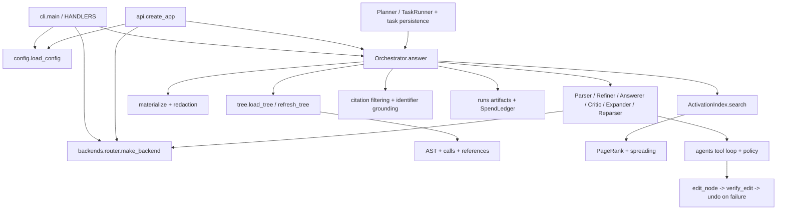

# atomic-flow — рабочая карта проекта

Обновлено **16 октября 2026**, коммит
`820fc83d1850b01baeb78a7a9e14035a3b44ddcc`, ветка `main`, версия пакета `0.2.0`.
Первоначально анализировался `656c8158`; после публикации изменений из Codespace клон обновлён fast-forward.
Источник: https://github.com/Akseleu-J/atomic-flow.git.

## Локальные исправления поверх HEAD — актуальный статус

18 октября: пакет 4 (`IMPLEMENTATION_STEP_4.md`): CI Python 3.11/3.12 + настоящий Docker job,
режим `--require-docker`, nonroot UID/GID хоста для приватных Unix workspace и новые integration tests.
Windows: **170 passed, 9 skipped**. GitHub Actions run `39102109420`, source `5a4fbc5`:
Python 3.11/3.12 jobs PASS; Docker job — **156 passed, 6 skipped** + **17 passed** + **6 real Docker passed**.
Логи и image ID: `validation/ci-20261018/validation-5a4fbc5d5cdc3b101d2558046a964586c06b0c22/`.
Codespace лимит исчерпан. Выбран маршрут: код локально, контейнерные проверки в GitHub Actions.
На ноутбуке 3.4 GiB RAM, свободно около 0.4 GiB; Docker Desktop не устанавливать.

Пакет 3: `IMPLEMENTATION_STEP_3.md`, `EXECUTION.md`. **151 passed, 4 skipped** + **17 passed**.
Общий command runner, Docker по умолчанию без local fallback, явный local режим, очистка окружения,
таймаут/отмена, durable cancel marker, task lease и проверка бюджета перед следующим шагом.
Подготовлен self-contained Colab notebook с хэшами текущего исходного кода.
В настоящем Colab установлен Docker; ограниченный контейнер не стартовал из-за read-only cgroups
(после перехода daemon на no-bridge/VFS). Это UNAVAILABLE, не подтверждение изоляции.
Полный source bundle в Colab ещё не запускался. Лог: `validation/step3-colab-preflight.md`.
Открыты: общий budget для planner/replanner, hard task cap, Windows Job Objects, recovery CLI lease,
запуск настоящего Docker integration на подходящей Linux-среде и фиксация image/dependencies.

Пакет 2 реализован: `IMPLEMENTATION_STEP_2.md`. Текущая проверка: **142 passed, 2 skipped** + **17 passed** отдельно.
Добавлены guarded source I/O, post-edit reindex/stable aliases, актуальный evidence context,
project/hash-bound undo, task workspace/checkpoint и journaled publish/recovery. --recover работает offline.
Private ATOMIC_FLOW_HOME исключён из индекса. Подробные границы staging и план следующего этапа — в отчёте пакета 2.
Ниже сохранена история пакета 1 и первоначального анализа; их старые ограничения нужно сверять с отчётом пакета 2.

Пакет 1 реализован в рабочем дереве, ещё не закоммичен: `IMPLEMENTATION_STEP_1.md`.
**111 passed, 1 skipped** штатно + **17 passed** в дополнительных root v3 tests.
Исправлены callback, audit ранних отказов, роль tools, edit opt-in, строгий Step verifier,
no-op edit и bootstrap сохранённого индекса для task. Tool errors/denials понижают итоговый ok.
Старые строки ниже о перечисленных разрывах относятся к предыдущему анализу, а не текущему дереву.
Следом: content-hash/reindex/changeset; затем sandbox и устойчивость budget/cancel/resume.
Сохранённый индекс теперь включает новые Python-файлы в src/tests и dirty state, не только tracked files.

## Актуализация после Codespace — читать первой

На `820fc83` закрыты прежние разрывы: добавлены `agents/task.py` (Task/Step/save/load/list_tasks),
`TaskConfig`, CLI `atomic task --list/--show/--resume/--cancel` и `execute_tool.result_summary`.
Полный штатный pytest теперь **75 passed, 1 skipped**; два новых root-level v3 test-файла,
не входящих в default testpaths, отдельно: **17 passed**. Логи:
`validation/pytest-820fc83.txt`, `validation/pytest-root-v3-820fc83.txt`.
`compileall src`, импорт TaskRunner и `atomic task --help` также успешны.
Это подтверждает локальное исполнение с fake backend, не live качество/стоимость агента.

Сохраняются: неверный `_approval_callback` в TaskRunner; недостаточная проверка отсутствующих/ошибочных
tool results; нет enforcement роли на dispatcher; устаревание дерева после edit; неоднозначный edit opt-in;
неизолированное исполнение pytest; path/hash/redaction разрывы инструментов.
В новом task-пути дополнительно проверить: бюджет контролируется только после провала шага;
planner/replanner не проходят общий ledger; --cancel меняет JSON, но runner его не перечитывает;
task_id не валидируется перед построением пути; resume не сверяет состояние исходников;
CLI при отсутствии tree строит его без save, а Orchestrator требует persisted tree.
`--dry-run` команды task вызывает модель для планирования: это не zero-call режим.

Новые `REVIEW_v3.md`/`PATCHES.md` — материалы предыдущего review, часть замечаний уже устарела;
`apply_phase01.sh` не запускался. `aqk_factorized.py`, `padding.py`, root `references.py` — дополнительные
материалы, сами по себе не интеграция в runtime. Производственный маршрут: `PRODUCTION_ROADMAP.md`.

Этот документ предназначен для восстановления контекста агентом перед следующей задачей.
Сначала прочитать его, затем проверить Git и открыть только затрагиваемые модули.
Снимок не отменяет проверку изменившегося кода. Продуктовый код при анализе не исправлялся.

## 1. Где работаем и как восстановить контекст

Клон: `C:\Users\omirb\OneDrive\Документы\ChatGPT\atomic-flow 2\atomic-flow`.
Внешняя папка `atomic-flow 2` уже содержала пустой Git-репозиторий; поэтому настоящий клон расположен вложенно.
Все команды Git/pytest/atomic выполнять из вложенного каталога.

1. Прочитать этот файл и выполнить `git status --short --branch`.
2. При другом HEAD посмотреть `git diff 820fc83..HEAD --stat` и релевантные изменения.
3. В `docs/project-index.json` найти нужные пути, импорты, символы и диапазоны строк.
4. Сверить изменённые файлы с сохранёнными SHA-256; читать их перед правками.
5. После изменений обновить затронутые разделы карты и при необходимости индекс.

`project-index.json` содержит статический инвентарь файлов и символов (счётчики — в самом JSON),
включая методы, вложенные функции, тесты и benchmark fixtures. Это статический AST-инвентарь,
а не точный граф исполнения. SHA-256 позволяет обнаружить дрейф. Новые untracked-файлы карты
намеренно не включены в исходный снимок. Генератор: `tools/update_project_index.py`, только стандартная библиотека;
команда `python tools/update_project_index.py`. Берёт tracked-файлы и новые src/tests Python-файлы, записывает HEAD и dirty state;
при dirty checkout хэши могут отличаться от содержимого коммита.

## 2. Назначение и границы

Локальная Python-платформа для вопросов об исходном коде и ограниченного редактирования через LLM.
Индексирует проект, выбирает релевантные узлы, формирует ограниченный контекст,
вызывает роли модели, фильтрует ссылки и проверяет упомянутые идентификаторы.
Есть CLI, FastAPI/OpenAI Chat Completions shim, три типа backend, локальные оценки и Kaggle-обвязка.

Это не реализованная универсальная IDE и не ML-training проект. JAX/Pallas и Gemini-код внутри
`benchmark_data/fixtures/` — корпус для чтения и поиска, а не рабочие зависимости шлюза.
Некоторые fixtures при импорте создают внешние клиенты; Kaggle task-файлы имеют top-level `.run(...)`.
Для инвентаризации их нужно парсить как данные, а не импортировать/исполнять.

Не реализованы: dense/atomic-core encoder, AST для других языков (они индексируются как файлы),
streaming API, TLS, per-user keys, полноценный rate limiting. Наличие planner/task_loop не означает,
что многошаговые задачи готовы к production: путь подключён, но требует исправления оставшихся разрывов.

## 3. Карта каталогов и точек входа

```text
pyproject.toml             Python >=3.11, setuptools, atomic -> atomic_flow.cli:main
src/atomic_flow/
  cli.py                  argparse, handlers, interactive approvals, dry-run, diagnostics
  config.py               Pydantic configuration, trust, layered settings, masked output
  tree/                   AST/files index, call/reference edges, personalized PageRank
  activation/             tokenization, lexical ranking, graph expansion, context/redaction
  llm/                    roles, schemas, orchestration, grounding
  agents/                 tool registry/loop/policy, edit verification/undo, planner/task persistence
  backends/               stdlib HTTP, OpenAI-compatible, Anthropic, Kaggle, routing
  api/server.py           FastAPI factory, auth, project-root checks, concurrency cap
  kaggle/credentials.py   dotenv parser, expiry/allowlist, redacted status, permissions
  budget.py               daily JSONL ledger and run retention
  benchmarking.py         free retrieval and paid/fake end-to-end evaluation
  benchmark_data/         cases.json (27), fixtures (13 Python files)
benchmarks/kaggle_tasks/   4 standalone hosted model tasks
tests/                    13 test modules + conftest; scripted fake backend
docs/                     architecture, roles, prompts, quickstart, troubleshooting
REVIEW.md                 historical 0.1 -> 0.2 review, not a fresh validation report
METRICS.md                historical model/retrieval results, not current-checkout evidence
.atomic_flow/             tracked focus.yaml + ignore; generated tree.json ignored
```

Основные связи:



## 4. Данные и индексация

- `tree/node.py::TreeNode`: `node_id`, path/symbol/kind, line ranges, parent, signature/summary,
  imports, raw calls, resolved callees/reference_ids, fan_in/out, file hash/size/mtime.
- ID: `path::Qualified.symbol`; файл — просто путь. Повторные имена получают `#2` и далее.
- `tree/builder.py`: `build_tree`, `save_tree`, `load_tree`, `refresh_tree`, `diff_trees`.
  **TREE_VERSION=4**; архитектурная документация и README ещё говорят v2.
- Файлы до 1 MB; allowlist расширений в `tree/defaults.py`; hidden paths, ignore patterns и корневой `.gitignore`.
  Python разбирается AST; неразбираемый файл остаётся file-node. Индекс хранит метаданные, не полные тела.
- Refresh сначала сравнивает size/mtime, потом при необходимости SHA-1; fingerprint из хэшей файлов.
  `_link` восстанавливает call/reference edges по именам: тот же файл, импорты, уникальное имя проекта.
  Это эвристический граф, не type-aware resolution: возможны ложные и пропущенные рёбра.
- `references.collect_references` собирает loaded names (шире одних callback-ссылок).
  В `_index_file` для метода lookup идёт по последнему компоненту symbol, хотя collector хранит полный scope;
  поэтому ссылки методов/вложенных определений требуют отдельной проверки.
- `pagerank.build_adjacency` строит неориентированный call/reference граф; поиск использует personalized PageRank.

## 5. Поиск и контекст

`activation/text.py`: snake/camel split, stop words, простое stemming, небольшой RU-словарь,
domain synonyms для gradient/state/chunk/Pallas; `register_synonyms` меняет глобальный словарь процесса.
Это лексический поиск с эвристиками, не semantic embeddings.

`ActivationIndex` строит inverted index один раз на дерево. Поля: symbol ×3, path/signature ×1.5,
summary ×1, callees ×0.7, imports ×0.4. Дальше exact-name priors, penalty tests/archive/benchmark,
смешивание lexical/PageRank 0.75/0.25 и spreading callees/callers/parent/references.
`weak` — покрытие query terms <0.2; это не вероятность качества ответа.
Orchestrator кэширует до 8 индексов по (project, fingerprint).

`materialize`: skeleton + ранжированные срезы с короткими aliases `n1...`, нумерацией строк,
дедупликацией включённых детей и снижением zoom для соблюдения приблизительного token budget.
Token estimate = ceil(UTF-8 bytes / 4), а не provider tokenizer. Zoom 2 обычно ограничен 80 строками,
zoom 3 показывает полное определение. `_Sources` проверяет containment и hash, маскирует известные секреты.
Полный бюджет запросов больше context budget: системные промпты, role state и tool-result history идут отдельно.

## 6. LLM pipeline и tools

`llm/orchestrator.py` — центр поведения. `answer` управляет request ID, artifacts, ledger;
`_answer` загружает индекс, подключает tools, выбирает контекст, роли и лучшую попытку.
`choose_mode` вызывается CLI/API; прямой вызов `Orchestrator.answer` сам auto-mode не выбирает.

| Режим | Основной маршрут |
|---|---|
| simple | retrieval -> Answerer; Parser при weak; verdict=unverified |
| medium | Parser -> retrieval -> Answerer -> Critic; максимум 2 попытки |
| hard | Parser -> Refiner -> Answerer/Critic; Expander и Reparser по verdict; config.max_attempts |

`_Run` учитывает токены/стоимость, пишет роль-промпты/JSON. Обычный invoke допускает две JSON-repair попытки;
tool loop — до 7 ответов backend при `TOOL_LOOP_MAX_TURNS=6`. Документы про один repair устарели.
`parse_json` переносит fences/prose вокруг объекта; LLM schemas lenient, `AnswerResult` strict.
Short aliases разрешаются обратно в node IDs; citations вне первоначального materialized context отбрасываются.
`grounding` проверяет только backticked identifiers; при отсутствии проверяемых имён может быть 1.0.
Ни grounding, ни critic verdict не доказывают правильность чисел, логики и всего ответа.

`agents/base.py` — Tool + ToolRegistry, `context.py` — состояние запроса.
`tools/__init__.py::ROLE_TOOLS`: Parser/Reparser без tools; Refiner читает/ищет;
Answerer имеет все 5 tools; Critic читает/запускает проверки; Expander ищет/читает/callers.
Tools: `read_node`, `search_tree`, `find_callers`, `edit_node`, `run_command`.
Вызовы — текстовый JSON protocol, без native tool calling провайдера.

`edit_node` заменяет существующее определение с **тем же именем**; это не общий patch/create/delete/rename engine.
Делает backup, temp+replace, py_compile + подходящие по имени тесты; failure ведёт к rollback.
`run_command` запускает фиксированный python -m pytest/ruff/mypy, shell=False, timeout и confinement target.
`UndoStack` хранит whole-file backup в user_dir/edits, доступен из следующего процесса.

## 7. Конфигурация, внешние сервисы и хранилища

`load_config`: defaults < user YAML < trust-gated project YAML < env. `AtomicConfig` extra=forbid.
Недоверенный проект не задаёт backend/default_backend/budget/artifacts; project prompts и policy тоже требуют trust.
Prompts: request > trusted project > user > builtin. `.env` автоматически не читается.

Backend contract: `ChatResult(content,tokens_in,tokens_out,cost_usd,latency_ms,truncated)` + `LLMBackend.chat`.
`router`: explicit/config default, затем первый пригодный backend по порядку конфигурации.
OpenAI-compatible и Anthropic используют `http.post_json` с retry/backoff и маскировкой ключа в ошибках.
Kaggle использует short-lived proxy credentials, allowlist/expiry, URL `/openapi/chat/completions`,
8192 output tokens по умолчанию, отключённый response_format JSON (промпт всё равно требует JSON).
Kaggle CLI login и Model Proxy token — разные уровни доступа.

User root: `ATOMIC_FLOW_HOME` или `~/.atomic_flow`:

| Путь | Назначение |
|---|---|
| config.yaml / trusted_projects.txt / prompts/ | пользовательские настройки и доверие |
| kaggle.env | proxy credentials, не выводить и не коммитить |
| runs/<request_id>/ | prompts, focus, role JSON, attempts, ledger, final.md, meta/error |
| ledger/<UTC-date>.jsonl | локальный дневной spend |
| edits/<edit_id>/ | original.py + meta.json |
| tasks/<task_id>.json | план, шаги, статус, current_index, расходы |
| benchmarks/runs/ | отчёты end-to-end |

Ledger учитывает известную стоимость; неизвестные цены обходят лимит, параллельные запросы не резервируют бюджет.
`artifacts.save=false` отключает сохранение prompt/source artifacts, но не сам spend ledger.
На Windows `prepare_secret_file` не создаёт private file; ACL выставляется после записи через icacls;
утверждение README о private-before-write относится к POSIX и не подтверждено для Windows.

API: `create_app`, GET `/health`, GET `/v1/models`, POST `/v1/answer`, POST `/v1/chat/completions`.
Bearer/X-API-Key, constant-time bytes comparison, root confinement, BoundedSemaphore (default 4).
Chat retrieval использует последний user turn; предыдущие 6 сообщений передаются как история.
`atomic up` за пределами loopback требует server key и project root; streaming возвращает 400.

## 8. Историческая проверка 656c8158 (новая проверка в начале документа)

Окружение: Windows, Python **3.12.14**, локальная `.venv`, editable install `.[dev]`.
Полные версии: `docs/validation/environment.txt` (в том числе pytest 9.1.1, Pydantic 2.14.1,
FastAPI 0.143.2). Lockfile отсутствует; это разрешённые текущие зависимости, не реконструкция старого окружения.
Kaggle/encoder/API-server uvicorn extras отдельно не устанавливались. Реальные LLM/Kaggle вызовы не выполнялись.

| Проверка | Результат | Доказательство |
|---|---|---|
| compileall src | PASS | выполнено bundled Python и затем .venv |
| import всех runtime-модулей, без fixtures | 47 OK, 1 ERROR: task_loop | validation/imports.json |
| полный pytest | ERROR при collection tests/test_task.py: отсутствует agents.task | validation/pytest-full.txt |
| pytest без tests/test_task.py | **63 passed, 1 skipped** | validation/pytest-available-verified.txt |
| CLI --help | PASS, task-команды нет | validation/cli-help.txt |
| free retrieval, k=5 | 13 scored: hit-all=0.923, mean recall=0.923, MRR=0.827 | validation/retrieval.json |
| Ruff src tests | 15 замечаний (5 I001, 5 F401, 2 B007, UP035, UP037, B904) | validation/ruff-statistics.txt |
| git diff --check | PASS для tracked diff | исходные tracked-файлы не менялись |

Пропущен POSIX permissions test на Windows. 8 task-тестов исключены вместе со сломанным модулем;
это не полный PASS проекта. Остальные тесты включают fake simple/medium/hard, HTTP TestClient,
index/refresh/context, policy, реальное локальное subprocess pytest, edits/undo, budget, CLI, retrieval.
Первый sandbox-прогон был искажён WinError 5 при temporary directories; успешный subset запущен
вне ограничений песочницы. Итоговый лог — `pytest-available-verified.txt`.

Единственный scored retrieval miss: `atomic-ops-backward-flow`; top-5 заняли inter-chunk forward/reference
и вложенный backward step, требуемые три backward nodes не покрыты. Порог unit-теста >=0.9 достигнут,
но CLI требует hit_all=1.0 и возвращает 1 при таком отчёте — это ожидаемое поведение текущего теста CLI.
Русские/negative cases частично исключены из retrieval scoring: 13 — не весь корпус из 27.

Последний исторический METRICS.md: 54/54 lenient, 51/54 strict, Gemini/Kaggle, 2026-10-13.
Сырые отчёты указаны там в Linux /home/codespace и /tmp и не входят в репозиторий.
Не переносить эти цифры на HEAD/Windows/текущее качество: сейчас измерен только локальный retrieval и fake tests.

## 9. Найденные разрывы и очередь следующей работы

Это исходная очередь чтения кода; выполненные пункты отмечены в IMPLEMENTATION_STEP_1.md и в начале этой карты.

| Приоритет | Где / проблема | Критерий готовности будущего исправления |
|---|---|---|
| Закрыто 820fc83 | task.py, TaskConfig и CLI task добавлены; полный pytest проходит | дальнейшая проверка реального end-to-end task workflow |
| P1 | TaskRunner присваивает orch._approval_callback, но Orchestrator читает approval_callback | integration test: callback проходит от runner к tool policy |
| P1, частично исправлено | result_summary добавлен; ранние policy/validation errors не записываются туда; exit_code=None считается успешным; py_compile verify без edits может пройти | неуспешный/отсутствующий check не даёт false done |
| P1 | ROLE_TOOLS ограничивает только описание в prompt; execute_tool не проверяет allowlist роли | запрещённый для роли tool не исполняется, даже если модель возвращает его JSON |
| P1 | approved edit очищает source cache, но не пересобирает nodes/aliases/index/context; следующая правка может использовать старые line ranges | сценарий двух правок со сдвигом строк сохраняет правильные определения и актуальные citations |
| P1 | read_node не применяет redact/hash/containment из _Sources; edit/undo также не имеют аналогичной проверки путей/устаревания | tests на stale tree, подмену path/symlink и секреты; отказ без записи вне project root |
| P1 | execute_tool при разрешённой policy принудительно edits_enabled=True даже без approve_edits; small trusted edits auto | согласовать продуктовый контракт согласия и реально проверять его перед записью |
| P2 | tools показывают новый source, но valid citations/grounding остаются привязаны к initial materialize context | прочитанные инструментом узлы учитываются как доказательства, без разрешения произвольных citations |
| P2 | reference scope lookup теряет квалификацию; incremental relink использует уже resolved references из cached nodes | regressions для методов/nested callbacks и сохранения reference edges на unchanged refresh |
| P2 | read_node zoom=2 обещает full body, но обрезает после ~81 строки; rename предлагается в prompt, edit требует прежнее имя | согласованные tool descriptions, явная truncation и поддерживаемый набор действий |
| P2 | русские action verbs заданы корнями с trailing word boundary; обычное 'переименуй/добавь' может не совпасть | RU intent regression cases и корректное определение action |
| P2 | dry-run без --no-translate может вызвать Parser для non-Latin запроса; SpendLedger(0), вызов не записывается обычным request finally | чёткий zero-call dry-run и корректный учёт разрешённого translation call |
| P2 | docs говорят tree v2, один repair, zero-call dry-run; реализация отличается | документация соответствует наблюдаемому поведению |
| P2 | backward-flow retrieval miss | сравнение до/после на том же corpus и расширенных независимых задачах; не снижать критерии ради PASS |
| P3 | 15 Ruff замечаний, нет lockfile и tracked CI | согласованный reproducible dev setup и нужные checks |

После пакета 1 закрыть freshness/changeset и execution isolation, затем улучшать retrieval.
Не начинать с платных бенчмарков, пока непонятно, какой путь проверяем и что считаем успехом.

## 10. Команды для продолжения

Из корня клона в PowerShell:

```powershell
$env:PYTHONUTF8 = '1'
& .venv\Scripts\python.exe -m atomic_flow.cli --help
& .venv\Scripts\python.exe -m compileall -q src
& .venv\Scripts\python.exe -m pytest -q
# Дополнительные тесты вне штатного testpaths:
& .venv\Scripts\python.exe -m pytest -q test_text_v3.py test_references_v3.py
& .venv\Scripts\python.exe -m atomic_flow.cli benchmark retrieval
& .venv\Scripts\python.exe tools/update_project_index.py
```

У `.venv` нет собственного pip-модуля; установка выполнена bundled pip через `--python .venv\Scripts\python.exe`.
Bundled runtime: `C:\Users\omirb\.cache\codex-runtimes\codex-primary-runtime\dependencies\python\python.exe`.
При Git HTTPS helper error задавать `GIT_EXEC_PATH` на bundled `native\git\mingw64\bin`, где находится git-remote-https.exe.
Для совершенно offline просмотра контекста использовать `ask ... --dry-run --no-translate` после `tree build`.
До обращения к backend задавать отдельный `ATOMIC_FLOW_HOME` в рабочем каталоге, чтобы не менять пользовательские настройки.

## 11. Маршруты точечного чтения

| Следующая задача | Открыть сначала | Проверять |
|---|---|---|
| Поиск/релевантность | activation/text.py, activate.py, tree/pagerank.py | test_activation, test_benchmark + free retrieval |
| Индекс/граф | tree/builder.py, references.py, node.py | test_text_and_tree, test_pagerank; добавить reference-refresh cases |
| Ответы/роли/citations | llm/orchestrator.py, schemas.py, prompts.py, verify.py | test_orchestrator; tool-context integration |
| Редактирование | agents/loop.py, policy.py, tools/edit_node.py, verify.py, undo.py | test_edit_tools, test_policy; multi-edit и rollback |
| Многошаговые задачи | agents/task.py, task_loop.py, planner.py, cli.py, tests/test_task.py | runner/backend integration, budget/cancel/resume и error propagation |
| Backend/Kaggle | backends/router.py, http.py, kaggle.py, kaggle/credentials.py | mocks без сети; live отдельно при соответствующей задаче |
| CLI/API | cli.py, api/server.py, config.py | test_cli, test_config_backends_api, test_phase0 |
| Оценка качества | benchmarking.py, benchmark_data/cases.json, METRICS.md | разделять retrieval, fake execution, live quality, strict/lenient |

Предыдущие локальные воспоминания использованы только как подсказка для validation-first проверки;
описание архитектуры и все текущие выводы сверены с новым GitHub-клоном. Глобальная память не менялась.
