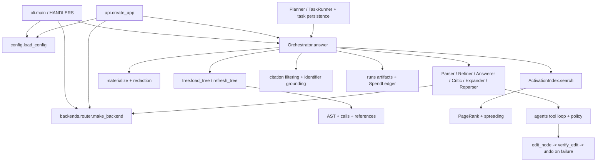

# atomic-flow — рабочая карта проекта

27 октября: принято **24/30 индивидуальных калибровок**.
SymPy13971 (CI 40447626567) и pytest7168 (CI 40448428457) прошли свежие
base/gold/wrong; архивы и исходные логи проверены по SHA256. Осталось
шесть Requests. Синтетическая сетевая топология принята (CI 40448994123);
первая сборка их старой среды остановилась на передаче inventory после
успешной установки 13 пакетов и ABI probe. Новых платных вызовов нет.
**P07 остаётся OPEN**: также нужны полный TaskRunner loop, matched pairs,
holdout и ablations. Подробности — P07_PROGRESS_2026-10-26.md.


P07 начат 26 октября: [текущий протокол](P07_PROGRESS_2026-10-26.md).
Бюджет пользователя расширен до $20 суммарно: фиксированные доли owner2 $9.50
и participant3 $10 плюс ранее учтённые $0.035611375 и резерв. Изолированная
калибровка v2: принято 10/30; свежие focused/v3–v5 и исторические среды довели общий свод до 22/30.
Первоначальные 20 блокеров подробно разобраны в
[аудите](P07_CALIBRATION_REMAINING_2026-10-26.md). Полный P07 остаётся OPEN.

26 октября — **P00–P06 host contracts ACCEPTED** на runtime `a5e5a31764231683e0741cfe7c5488d5dd408251`.
[Финальная приёмка](P00_P06_FINAL_INTEGRATION_2026-10-26.md): 44/44 критериев,
по 1423 PASS на Python 3.11/3.12, все 14 SKIP реально покрыты Windows/Docker,
301 source/test hash и пять CI-архивов проверены. Следующая глава — P07:
оставшиеся калибровки, равные лимиты baseline/atomic и независимая оценка utility;
до запуска чужих setup/tests требуется принятый изолированный executor.
P07: проверены все 30 CI-архивов v2, принято 10/30 калибровок (6/30 — прежний round7). R1/R3/R4: 21 платный вызов, патчей нет; R2: 0 вызовов. Расход с прежними $0.0008: $0.035611375. Linux source preflight всех трёх pilot-проектов и настоящий HTTPBin HTTP/CA-HTTPS в network=none прошли; это не качество модели и не калибровка Requests. Sonnet task creation вернула HTTP499: платный schedule не отправлен, повтор требует сверки remote state. Текущие результаты — docs/P07_PROGRESS_2026-10-26.md. Четыре production-блока остаются OPEN.
Нижние записи — история; их OPEN-статусы P00–P06 заменены этой приёмкой.


26 октября: [P00–P06 integrated acceptance](P00_P06_FINAL_INTEGRATION_2026-10-26.md).
Полная матрица 44 исходных критериев, независимый review и новые regression fixes
подготовлены; единый CI на общем коммите ещё ожидается. Старые CI не относятся
к текущему diff. Детали и четыре оставшихся production-блока — в отчёте.

Package 41 (25 октября): [P06 matrix и original goal accounting](IMPLEMENTATION_STEP_41_P06_MATRIX.md). Runtime da67d89 сохраняет исходные goal IDs/caps/scopes/links при доказуемой замене и устраняет stale project bytecode в pytest checker. Полная public multi-file failure→repair→publish→graph journey реализована; CI 40221853531 / 40221853379 SUCCESS: по 1296 PASS / 14 SKIP, 277 source hashes verified; 9/9 host rows PASS на обеих Python versions, real Docker/composition и wheel matrix PASS. Evidence — в отчёте. Независимый P06 review и четыре production-блока остаются OPEN.

Актуализация package 40 (25 октября): [P06 typed failures и durable repair ceiling](IMPLEMENTATION_STEP_40_P06_REPAIR.md). Runtime f9fd48d5bacce8b3c93bf9b15677df3f7edbc4b3: host-typed source/attempt-bound failure receipts и persisted repair allowance на physical admission/settlement/resume/publication. Предыдущий metadata-only cap заменён реальным guard. Полный P06 и четыре production gates остаются OPEN; CI 40219160156 / 40219160140 SUCCESS; по 1280 PASS / 14 SKIP на Python 3.11/3.12, 273 source hashes verified, real Docker/composition PASS. Границы evidence — в package 40. Новых provider calls=0.

Обновлено 25 октября 2026 после сверки ночных пакетов и локального продолжения.
Работать из этого репозитория `atomic-flow/`; внешний родитель — другой Git root.
Ветка `experimental`, draft [PR №2](https://github.com/Akseleu-J/atomic-flow/pull/2),
версия пакета `0.2.0`. Протоколы: [GITHUB_WORKFLOW.md](GITHUB_WORKFLOW.md) для GitHub;
[REAL_API_BENCHMARK_PROTOCOL.md](REAL_API_BENCHMARK_PROTOCOL.md) для live API и Kaggle runs.

## Текущий статус — читать первым

Продолжение 25 октября: [P00–P06 marathon report](P00_P06_MARATHON_2026-10-25.md).
Runtime 395b8ac: Python Git ingestion с admitted reconciliation/CAS, UA resource
adapters, scripted semantic stage + SDK и hash-bound range patch. P06 failure/lineage
wiring опубликован. Полные главы не объявлены закрытыми; точные gaps и self-review
указаны в отчёте. Новый CI и source-bound evidence: validation/marathon-20261025/.
Первый checks run на c6e4bc9 был RED (устаревшее failed-vs-paused ожидание);
история сохранена, accounting assertions усилены. Финальный runtime CI 40212848955
и 40212848950 SUCCESS: по 1260 PASS / 14 SKIP на Python 3.11/3.12; 271 source
hash verified; real Docker и composition PASS. Provider calls в этом пакете=0.


Для передачи основной работы другому помощнику:
[ASSISTANT_HANDOFF.md](ASSISTANT_HANDOFF.md) — snapshot на `a638e96`, карта кода,
контракты, первое поручение P06, порядок глав и критерии приёмки. Четыре production
блока не заменяют главы P06–P14 и корпоративную программу E00–E08.

Package 39 реализует оставшиеся host contracts P05:
[IMPLEMENTATION_STEP_39_P05_ACCEPTANCE.md](IMPLEMENTATION_STEP_39_P05_ACCEPTANCE.md).
Revision-bound receipts, conservative stale-premise pause, bounded 1–3 child
expansion/max8/history128, descendant horizon, goal scopes/caps и terminal cancelled
встроены в прежний runtime. Local JUnit: **208 PASS / 2 SKIP**, 210 unique cases;
Ruff/compile PASS. P05 ядра ACCEPTED для `91d22e2d1ed3e4d415bbb72076503cc4c6bf2fe3`:
оба workflow `40175334384` / `40175334261` SUCCESS. Python 3.11 и 3.12:
1197 PASS / 14 SKIP каждый; real Docker, 12 installed-wheel jobs и три real
LSP/MCP composition scenarios PASS. Скачанные host artifacts проверены по ZIP
checksum, JUnit и normalized SHA256 всех 255 src/tests Python files. Tested PR
merge `be9fb63` имеет тот же tree `c95e2db`, что опубликованный head.
Evidence: `validation/p05-ci-20261025/verified.json` (individual 12 wheel archives
не скачивались этим пакетом; CI jobs passed).
Evidence: `validation/p05-closure-20261025/`. Docker-free core не означает isolated
local execution; quality/scale/release/isolated-worker production gates сохраняются.

## История implementation packages

Ниже сохранены статусы на момент подготовки пакетов. Старые OPEN/working diff/
«не опубликовано» не отменяют финальную приёмку package 39 выше: packages 35–39
уже опубликованы в runtime `91d22e2`, evidence follow-up — `a638e96`.

Локальный package 38 — P05 bounded hierarchy и reviewed acceptance metadata:
[IMPLEMENTATION_STEP_38_P05_GOALS.md](IMPLEMENTATION_STEP_38_P05_GOALS.md).
Goal IDs/parents/criteria сохраняются и входят в approval; legacy canonical
digest без metadata сохранён. Bounds: 32 goals/generation, depth 4, history128.
Step context и replan получают требования; done не означает semantic acceptance.
Internal hierarchical replan требует fresh review. Финальный offline selection:
**107 PASS / 1 FAIL (MemoryError)**; Windows имела около 76 MiB physical / 276 MiB
virtual free. Manifest status=failed; initial rollback failures сохранены, их
причина не установлена. Ruff/compile PASS. Повтор acceptance нужен после снятия
host memory pressure; P05 evidence/revisions/rolling expansion/CI остаются OPEN.

Локальный package 37 — P05 rolling frontier:
[IMPLEMENTATION_STEP_37_P05_FRONTIER.md](IMPLEMENTATION_STEP_37_P05_FRONTIER.md).
Scheduler и read-only `TaskRunner.explain_next` используют общий расчёт ready/
blocked; bounded context показывает до трёх доступных шагов и существующие ledger
references. Unresolved running step останавливает scheduling до reconciliation.
**82 passed** в основном offline selection; 12 frontier tests повторно PASS после
финального ограничения reference length (не складывать counts). Ruff/compile PASS.
Evidence: `validation/p05-frontier-20261025/`. P05 hierarchy/criteria/revision-bound
evidence остаются OPEN; это локальный working diff, без нового commit/CI/live calls.

Следующее локальное продолжение 25 октября — P04 step-focused read-plan cache:
[IMPLEMENTATION_STEP_36_P04_STEP_CACHE.md](IMPLEMENTATION_STEP_36_P04_STEP_CACHE.md).
Цели берутся из текущего шага, context-pack AST facts переиспользуются по content
revision, изменённые файлы обновляются отдельно. Scanner применяет общие source
admission/limits/cancel; кэш не даёт read authority. Текущие selections:
**101 passed / 1 skipped** (JUnit без пересечений), Ruff/compile/diff PASS.
Это локальный пакет поверх package 35, не новый commit/CI. Полный обход и hashing
для reconciliation, legacy source-index refresh и четыре production-блока остаются.

25 октября: ночные P00/P01/P02-1/P03-1/P04-1/P04-2/P05-1/P02-2/P06-1
существуют на HEAD `20cdd7767ad846ad42dd9d08fcd709c4d5c11b0d`. Два workflow
этого HEAD подтверждены SUCCESS: `40159998948` и `40159998952`.
В текущем рабочем дереве добавлен P06-2 opt-in internal replan, исправлены
persisted graph CAS/unresolved-addition relink и project binding invalidation.
Результаты и ограничения: [IMPLEMENTATION_STEP_35_P06_INTERNAL_REPLAN_REVIEW_FIXES.md](IMPLEMENTATION_STEP_35_P06_INTERNAL_REPLAN_REVIEW_FIXES.md).
Это локальные изменения, не новый проверенный CI commit. Providers/vault/Kaggle
не вызывались. На момент package 35 P04 pack ещё делал clean build на шаге; package 36
выше заменяет этот planning path, но full delta hot-path,
полные P00–P14/E00–E08 acceptance и четыре production-блока не закрыты.
Финальные непересекающиеся локальные selections: **168 passed / 2 skipped**
(79 focused + 85 neighboring + 4 CLI); Ruff/compileall/diff PASS.

Далее — дорожная карта и датированные evidence предыдущих проверок. Старое
утверждение «production-код не менялся» относится к review 24 октября ниже.

План следующей программы по запросу владельца:
[PRODUCTION_ROADMAP.md](PRODUCTION_ROADMAP.md), P00–P14 OPEN: UA graph mechanism,
delta refresh → subtask DAG/rolling planning → bounded autonomy → utility →
efficiency/reliability/release → IDE/browser/multilanguage и measured differentiation.
Reference закреплён на UA `e24fcf6d371bcfa529bc110bacb1bb43de1b8d33`:
[source review](UNDERSTAND_ANYTHING_REFERENCE_2026-10-24.md).
Полные этапы остаются OPEN; реализованные ночные срезы и локальное продолжение
перечислены выше и не равны завершению всей программы.

Дополнение к roadmap после критики ядра:
[CORE_CRITIQUE_RECHECK_2026-10-24.md](CORE_CRITIQUE_RECHECK_2026-10-24.md),
[ENTERPRISE_CORE_PLAN.md](ENTERPRISE_CORE_PLAN.md), E00–E08 OPEN.
Fresh offline probes подтвердили grounding=1.0 при checked=0 и при неверной логике
с известными именами; это ограничение answer heuristic, не обход host completion.
11 focused regressions PASS (26.36 s, вне Windows desktop sandbox из-за temp ACL).
Новых provider calls=0; production-код не менялся. Corporate core имеет отдельный
headless acceptance gate; четыре W8/W7/release/production блока остаются открытыми.

Глава аудита/сверки и scoped исправлений завершена на runtime
`0dbd5938958074eae4ff73f6424f06425a525909`. Оба push workflow PASS:
[checks](https://github.com/Akseleu-J/atomic-flow/actions/runs/40101171166),
[release/composition](https://github.com/Akseleu-J/atomic-flow/actions/runs/40101171149).
Python 3.12 job: **1021 passed / 14 skipped**; Docker validation: **1004 CPU /
17 extra / 26 execution passed** (наборы пересекаются). Все 12 wheel combinations
и три real Linux LSP/MCP composition scenarios PASS. Скачанные artifacts проверены
на tested commit, hash скрипта и source bytes всех 133 Python-файлов каждого wheel:
8 wheels совпали побайтно, 4 Windows wheels отличаются только CRLF.
Evidence: `validation/ci-production-review-20261024/evidence-manifest.json`.
Четыре оставшихся production-блока перечислены в конце `PRODUCTION_PLAN.md`.
Новых provider calls в этой главе не было, PR остаётся draft.

Проверенная исходная точка этого review: `445f1b9f036111de0c2113884cc9eb65e78749e1`;
на момент сверки `HEAD...origin/experimental` = `0 0`.
Пакеты 18–25 и исправления пилота уже закоммичены. Это не незакоммиченный `8a18fbe`.
После дальнейших runtime-изменений результаты CI этого SHA нельзя автоматически
переносить на новое дерево; финальный tested SHA записывается в evidence manifest.

GitHub подтвердил два зелёных PR workflow для head `445f1b9`:
[Project/container checks](https://github.com/Akseleu-J/atomic-flow/actions/runs/40088135253)
и [External interoperability/installed release](https://github.com/Akseleu-J/atomic-flow/actions/runs/40088135306).
PR job проверяет свой merge checkout: точный tested commit берётся из artifact,
а не подменяется head SHA. Matrix: Windows 2022, macOS 14, Ubuntu 24.04 × Python
3.11/3.12 × core/API; реальный pylsp/MCP и Docker проверяются отдельными jobs.
Зелёный CI подтверждает эти сценарии, а не все критерии production readiness.

Актуальный план и критерии выхода: [PRODUCTION_PLAN.md](PRODUCTION_PLAN.md).
Независимая сверка отчёта: [REVIEW_PRODUCTION_2026-10-24.md](REVIEW_PRODUCTION_2026-10-24.md).
Исторический аудит/исходный W1–W9: `audit-2026-10-23/PRODUCTION_PLAN.md`.

Приняты и дополнительно исправлены source leases/publication, index CAS/limits,
API admission, provider usage/routing, durable reconciliation, owned Windows
process jobs, staged capability factory и installed-wheel pipelines. Границы
описаны в `IMPORT_REVIEW_2026-10-24.md` и трёх `IMPORT_*_REVIEW.md`.
Локальные focused counts в этих документах пересекаются: их нельзя складывать.
Другой checkout `.zcode/.../atomic-flow` остаётся на `c8820ff445b318c3fbf1c3cf76451ebe30a27774`;
его результаты 850/33 не заменяют проверку нынешней версии.

## Что действительно показал живой пилот

Одна открытая задача `sympy__sympy-21614`, fixed Gemini Flash Lite, только
авторизованный аккаунт владельца №2, последовательные запросы. Все сохранённые
попытки, включая parser debug: **23 физических вызова, $0.0364695 quota cost**.
Atomic: шесть запусков, **19 вызовов / $0.030702175**; baseline: три основных
запуска плюс debug, **4 вызова / $0.005767325**. Отдельный infrastructure failure
с нулём вызовов сохранён; неизвестная стоимость такого отчёта не объявляется нулём.

Доступные семь per-run quota snapshots согласуются с соответствующими расходами
с погрешностью float. Для трёх платных ранних запусков snapshots отсутствуют;
сумма всех reported costs согласуется с финальным дневным used, но это не
полная независимая сверка каждого запуска.

Baseline видел issue и ограниченный фрагмент Derivative (до 550 строк/32 KB),
а не весь исходный файл. Его кандидат **requirement_failed**: деление kind
вызывает TypeError уже на первой скалярной проверке; матричная проверка до этого
не доходит. Atomic в финальном запуске за шесть вызовов не получил допустимую
правку; read-before-edit/пагинация/точный old_text были сохранены. Принятого
кандидата нет. Это отрицательный exposed development pilot, не matched comparison:
между запусками менялись limits, исправлялась инфраструктура, task/gold уже известны.

Base FAIL / gold PASS / plausible wrong FAIL калибровка одной задачи подтверждена.
Остальные 29 исторических окружений не откалиброваны. Корпус 30 задач существует;
полного 30-task/60-arm результата, blinded holdout и доказанного преимущества нет.
Подробности: `IMPLEMENTATION_STEP_24_EVALUATION.md` и `validation/import-20261024/`.

## Технические границы и ближайшая работа

Реальный staged TaskRunner edit→checker→publish с pylsp/MCP уже проверен.
Расширенный W6 локально и в exact-source Linux CI прошёл три сценария: public prepare/review/approve/resume,
Python+notebook edits→pytest→publish, cancel/conflict и recovery без новых calls.
Точный script SHA и observed states: `validation/step23-integrations/composition-final-result.json`.
W7 имеет bounded snapshot и потоковый journal read/recovery; append всё ещё
перечитывает hash prefix, поэтому долгий session имеет квадратичную суммарную работу.
Замена этого поведения должна сохранить проверку целостности и crash recovery.
Измерение SymPy ~179 s не является p95/SLO и не доказывает, что оба rebuild лишние:
workspace и опубликованный source требуют разных актуальных индексов.

Core/CLI/SDK/API устанавливаются без Docker: `IMPLEMENTATION_STEP_25_DOCKER_FREE.md`.
Trusted local/Windows Job Object отвечают за lifetime, не filesystem/network isolation.
Для непроверенного выполнения нужен явно принятый sandbox/remote worker; silent
local fallback запрещён. Полного native sandbox сейчас нет.

Routing не обещает unlimited free API. Переключение допустимо лишь при подтверждённом
отказе до inference/исчерпании разрешённого route; unknown outcome сохраняет hold.
Аккаунты участников учитываются отдельно; account rotation для обхода ограничений
не является fallback. Ключи только process-local, не в CI/ноутбуках/evidence.

## История проверок до текущего review

Далее сохранены датированные записи прошлых этапов. Слова «финальный», «текущий»,
«не закоммичен», model_calls=0 и старые ограничения внутри них относятся к тому
этапу и SHA; они не заменяют текущий статус выше и актуальный production plan.

23 октября: пакет 17 — исправлены конкретные R01–R07 из critic pass:
private-path execution exclusion, приватный snapshot для model checks вне TaskRunner,
decoded output/diagnostic/artifact redaction; isolated installed checker bootstrap
и zero-test gate; host unresolved-effect latch с mandatory journal при artifacts off,
pause/no-replan/no-publish и CLI/API/SDK error; workflow completed/uncertain effects,
delayed replan; finite calibrated answer rubric и parsing-independent durable
evaluation attempt sidecars. Контракты и ограничения — `IMPLEMENTATION_STEP_17.md`.
Исторический critic evidence сохранён. Один из targeted Windows rechecks **81 passed /
1 Docker-only skipped**, Ruff/compileall PASS. Expanded risk run **337 passed /
12 skipped / 3 changed-error-message failures**; отдельный последующий recheck
**134 passed / 1 skipped / 2 synthetic native-fixture failures**. Причины устранены,
исходные logs сохранены; числа не суммируются как уникальные тесты. Новые Docker
regressions добавлены в обязательный CI; финальные exact-source results приведены ниже.
Model calls scripted, paid API calls=0. G01 live edit quality, G02 release/wheel и
G03 scale/capability composition остаются открытыми. Не заявлять универсальную
redaction/semantic verification или production readiness.
Первый fixes runtime `a0a4de5` получил 788 CPU / 17 extra / 26 execution PASS,
но один advisory regression отказал из-за консервативной unknown-effect классификации
pure read preflight; общий CI failure, calibration skipped. Raw failure artifact
сохранён в `validation/ci-step17-before-fix-20261023/`. Исправлена только отдельная
preflight ветка Patch/Delete/Move, post-write exception latch сохранён.
Affected recheck **36 passed**, `validation/step17-preflight-final-windows.txt`;
Последующие fixes сохраняют SourceConflict API через SourcePreconditionFailed;
post-edit matching checks также используют private checked_workspace. Финальные
локальные rechecks: 73 passed / 4 skipped и 54 passed / 1 skipped; logs сохранены.

Финальный runtime **`78f0df5c2abf18fc4b0035030a92178335134e04`**: push CI `39970683119` и PR CI `39970691727`
PASS, Python 3.11/3.12. Скачанный exact-source artifact: **792 CPU passed / 11 skipped, 17 extra passed, 26 execution acceptance passed**
(10 real Docker checks, 16 supporting CPU/local jobs); compile и historical
six-change grader calibration PASS, model_calls=0. Image ID:
`sha256:06fd74d44e2ba0d9d4b0835424c0921378e50f990695e82c0b79a91ff46e6b47`.
`validation/ci-step17-20261023/evidence-manifest.json` связывает исходные
**12 artifact files** и **31 changed source/test/tool Git blobs** с tested commit.
Это проверка конкретных R01–R07 regressions, а не production/live-edit acceptance.


23 октября, исторический независимый critic pass до пакета 17: `CRITICAL_REVIEW_2026-10-23.md`
и `COMPETITIVE_ACCEPTANCE.md`. Три AI-reviewer с отдельными контекстами;
основной агент повторил отобранные offline repros. Подтверждены **7 дефектов**:
private snapshot/output redaction bypass, checker module shadowing, продолжение
effects после uncertainty, потеря completed workflow effects, delayed replan,
ложные QA grades и потеря usage failed legacy benchmark attempts. Дополнительно
зафиксированы evaluation/release/scale/integration gates. На runtime `58b3dd4`
находки **не исправлены**; прежний CI PASS их не исключает. Evidence:
`validation/critic-20261023/`. Только synthetic credentials/models/local test
projects; внешние model API/vault не использовались. Новые реальные Docker repros
не запускались. Это внутренний AI review, не внешний pentest/certification.
Выбранное тогда направление — закрыть R01/R02/R03, затем остальные regressions и Stage 4;
конкретные R01–R07 исправлены пакетом 17 выше, дальнейшие G01/G02/G03 открыты;
62 scoped implementations не считаются production acceptance.

23 октября: пакеты 15–16 завершают каталог до **62 implemented_scoped / 0 planned**.
Три субагента параллельно реализовали MCP/IDE, extensions/workflows/hooks и read-only
workers; основной агент — HTTPS docs connector, CLI/SDK/dispatcher и risk integration.
Контракты: `IMPLEMENTATION_STEP_15.md`, `IMPLEMENTATION_STEP_16.md`. MCP stdio client /
offline source server, authenticated readonly IDE bridge, digest-approved static
workflows и trusted plugin factories/hooks, exact-host HTTPS documentation fetch /
lexical search по 1–8 явным pages, deferred component loaders. Workers имеют отдельный
context/read_source scope и durable advisory handoff; тот же TaskBudgetBackend
сериализует parent/worker calls и общий учёт. Нет writable workers, OS sandbox для
host callbacks, marketplace, общего web index или готового IDE editor extension.
External/model data не выдаёт permission/read proof. Production Stage 4 остаётся открыт.
Новые tools deferred; capabilities передаются только host SDK, не HTTP model input.
Startup: fresh-process median catalog 0.701 s / 29.36 MiB, LSP symbol 1.366 s /
32.25 MiB, MCP symbol 1.049 s / 30.04 MiB; три samples, без запуска services/inference.
`validation/step15-startup-windows.json`. Focused checks и exact-source CI результаты
приведены ниже; paid model calls=0.

Проверка пакетов 14–16: промежуточный полный Windows baseline пакета 14 **641 passed /
22 skipped** (`step14-windows-final.txt`) предшествует последним integration правкам.
Focused changed/risk run: **360 passed / 4 skipped / 1 failed**; failure — тест ожидал
host mutation proof от model-facing workspace_read. Контракт намеренно не выдаёт
этот proof; fixture исправлен на отдельный host read и проверяет отказ до него.
`validation/step14-16-windows-focused.txt` сохраняет исходный failure для provenance.
Финальный recheck изменённых workspace/IDE/hooks/CLI мест: **47 passed / 1 skipped**,
`validation/step14-16-windows-recheck.txt`; Ruff и compileall PASS. Полный локальный
набор повторно не запускался по просьбе пользователя. Push CI `39938719112` и PR CI
`39938724913` PASS на runtime `58b3dd494ee038f5303386d3e527012150444e34`, Python
3.11/3.12. Скачанные artifact logs подтверждают **735 CPU passed / 10 skipped**,
**17 extra passed**, **25 execution acceptance passed** (9 real Docker и 16
supporting CPU/local job tests). Compile и historical six-change grader calibration
PASS, model_calls=0. Image ID
`sha256:5f98df166b2a51efc8fb7d093930763beeafc070f2abfa9f37df26ae7074e855`.
`validation/ci-step14-16-20261023/evidence-manifest.json` связывает все **12** исходных
artifact files и **48** изменённых source/test/tool Git blobs с tested commit.
Raw artifact bytes сохранены без line-ending normalization. Это не подтверждение
реального analyzer/server compatibility, внешнего deployment или live edit quality.


23 октября: пакет 14 — notebook source-only cell read/preview/apply со стабильными IDs,
explicit legacy migration, hash-bound output/trust clearing и journal rollback;
host-approved LSP UTF-16/full-sync definitions/references/versioned diagnostics/checked
textual WorkspaceEdit; bounded source hash polling/debounce и root-qualified explicit
grants/read/session one-root publication. CLI/SDK/tool dispatcher integration,
deferred tool schemas, notebook final structure gate и dialogue whole-file hashes.
`IMPLEMENTATION_STEP_14.md`; каталог **52 scoped / 10 planned**. Watcher default off,
same-size/mtime source index теперь проверяет bytes. Canceled/rejected read result
не оставляет новый ToolContext read proof. Root proof не переносится между root IDs
или в active-project authority; model/HTTP input не запускает LSP executable.
Focused integration **91 passed / 2 skipped** и полный Windows baseline **641 / 22**
относятся к промежуточным срезам; subsequent integration/risk checks описаны выше. Synthetic protocol server,
без real analyzer install или notebook kernel execution; cross-root atomicity и
multi-root TaskRunner не реализованы. Stage 4 live edit evaluation остаётся открытым.

23 октября: пакет 13 — durable host jobs с snapshot/cancel/reconcile, потоковым prefix
output/HMAC cursors/retention и global active admission; fixed checks/read-only Docker
profiles; process-only project/connector/operation credential grants; private Git
worktree snapshot backend; сменяемый hash-bound Linux Docker worker protocol и SDK.
`IMPLEMENTATION_STEP_13.md`; каталог **48 scoped / 14 planned**. Unknown process cleanup
не освобождает admission slot; durable cleanup только по immutable CID, не PID/name.
Секреты не попадают в child env; broker callbacks доверенные, не Python sandbox.
Remote submit uncertainty сохраняется через broker; recovery только journal lookup.
Worker hashes не являются attestation. Внешний cloud endpoint не развёрнут.
Начальный полный Windows прогон: 544 passed / 20 skipped / 2 failed; сохранён в
`validation/step13-windows-before-integration-fixes.txt`. Выявлены transient taskkill
timeout и regex spawn deadline; оба isolated recheck PASS. Исправлено fallback kill
при helper failure (исход остаётся unknown), helper pipes убраны; startup regex
ограничен отдельно от прежних 5 секунд evaluation, добавлены regression tests.
Focused integration recheck **74 passed / 8 skipped**, Ruff/compileall PASS.
Финальный Windows **548 passed / 20 skipped**, `validation/step13-windows-final.txt`.
CI push `39923289564` и PR `39923295523` PASS на точном runtime `dea7fa7`, Python
3.11/3.12. Скачанный artifact: **541 CPU passed / 10 skipped**, **17 extra passed**,
**25 execution acceptance passed** (9 real Docker, 16 вспомогательных CPU/local jobs),
compile и historical grader calibration PASS; model_calls=0. Image ID
`sha256:16a1faebd1207bda37d77cf05f2139208f2edfc8364753bc03aa747746bbd586`.
`validation/ci-step13-20261023/evidence-manifest.json` связывает все 12 artifact files
и 20 изменённых source/test/tool Git blobs с tested commit. Raw logs сохранены без
нормализации. Windows/CPU пропуски не считаются Docker acceptance.
Продолжение notebooks/LSP/watchers/multiple roots описано выше. Stage 4 live
multi-repository edit quality остаётся открытым; model_calls=0 для implementation/validation.

23 октября: пакет 12 — review/revise/approve по plan/source/scope digest, task schema 2,
зависимости/blocked steps, structured summary, explicit project memory CRUD/selection,
новые запросы resume/fork без action replay и preview-bound recoverable source rewind.
Три субагента реализовали независимые блоки, основной агент соединил CLI/SDK/API/runtime.
`IMPLEMENTATION_STEP_12.md`; каталог **42 scoped / 20 planned**. Будущая версия,
неизвестные charges/effects, stale source/approval блокируют соответствующее продолжение.
Сводка/память не дают permissions/read evidence. Продолжение jobs/credentials/execution
описано выше; общие production и multi-repository quality gates остаются открыты.
Windows **490 passed / 16 skipped**, Ruff/compileall PASS;
`validation/step12-windows-final.txt`. 16 skip включают Docker-only и Windows platform/
symlink ограничения. Новые model calls scripted. CI push `39889275052` и PR
`39889279922` PASS на точном source `394aedc`: Python 3.11/3.12;
**483 CPU + 17 extra + 6 real Docker passed**, calibration PASS, model_calls=0.
Скачанные tested-commit/results/logs и manifest всех 12 artifact files / 29 source
blobs — `validation/ci-step12-20261023/`.

22–23 октября: пакет 11 — bounded version 1 events/SDK, API SSE controls/disconnect,
CLI JSONL, boundary-safe steering, cancellable local HTTP wait и outcome-aware retry.
Обычный ask теперь имеет durable per-call reservations/settlement без aggregate
double counting. Отмена после отправки оставляет unknown charge; fully received
response учитывается до cancel. Remote inference не обещаем остановить.
`IMPLEMENTATION_STEP_11.md`, `src/atomic_flow/runtime.py`, `sdk.py`, `tests/test_run_control.py`.
На момент пакета 11: **35 scoped / 27 planned**; продолжение требований —
`REMAINING_IMPLEMENTATION.md`. Windows **391 passed / 13 skipped**,
Ruff/compileall PASS, `validation/step11-windows-final.txt`. CI push `39862268360`
и PR `39862274999` PASS на точном source `39e359a`: Python 3.11/3.12,
**381 CPU + 17 extra + 6 real Docker passed**, historical calibration PASS.
Скачанные tested-commit/results/logs и SHA-256 manifest — `validation/ci-step11-20261023/`.
Проверки scripted, без внешних paid model calls.
Stage 4 multi-repository edit quality остаётся открытым.

22 октября: пакет 10 — lazy tool catalog/host factories, data-only provenance,
revision-bound diagnostics и final host completion gate перед публикацией Task.
`IMPLEMENTATION_STEP_10.md`; Windows **363 passed, 13 skipped**, Ruff/compileall PASS.
На момент пакета 10: **29 scoped / 33 planned**, `CANDIDATE_STATUS.json`. User-approved scope
остаётся весь оставшийся каталог, но planned пункты не объявляются реализованными.
Платные model calls не использованы; это scripted/CPU проверки, не task quality.
Docker artifact CI `39793671877` подтверждает точный source `e9c50bf`: **353 CPU +
17 extra + 6 real Docker passed**, calibration PASS; `validation/ci-step10-20261022/`.
Run conclusion success; API jobs-list в этот момент возвращал queued, поэтому
опора — скачанные tested-commit/results/logs, не один status badge.
Продолжение оставшихся требований с зависимостями и acceptance gates:
`REMAINING_IMPLEMENTATION.md`; пакет controls/events/cancel/SDK описан выше.

22 октября: пакет 9 — native function transport для opt-in OpenAI-compatible
backend, один call/ответ, IDs и host-owned pairing, общий dispatcher и budgets;
Kaggle сохраняет text-JSON. `IMPLEMENTATION_STEP_9.md`. Windows **344 passed,
13 skipped**, Ruff/compileall PASS. Только scripted HTTP, не live paid models.
CI `9272c1d`: push `39789172874` / PR `39789178362` PASS; Docker 334 CPU + 17 extra
+ 6 real Docker, calibration PASS. Evidence `validation/ci-step9-20261022/`.

22 октября: пакет 8 реализован, `IMPLEMENTATION_STEP_8.md`: find_files, line-range read,
parallel reads opt-in, policy explain/lint, effective config origins, expanded offline doctor,
proactive history pressure/byte breakdown, backend capabilities, per-role usage/cache diagnostics.
Пользователь разрешил продолжить остальные пункты каталога с тестами. Весь каталог
после этого пакета содержал 24 scoped / 38 planned; актуальный статус см. выше.
Windows: **334 passed,
13 skipped**, changed-code Ruff/compileall PASS; `validation/step8-windows-final.txt`.
CI `ea60439` PASS: push `39786981570`, PR `39786986720`; Docker **324 CPU + 17 extra
+ 6 real Docker**, calibration PASS. Evidence `validation/ci-step8-20261022/`.

22 октября: начат evaluation gate, `EVALUATION_PILOT.md`. Калибровка 6 известных
исторических изменений (12 RU/EN формулировок): base 6 FAIL / gold 6 PASS локально,
0 model calls; Docker calibration PASS на `1fe4abe`, push CI `39727907865` и PR CI
`39727911516` PASS (Python 3.11/3.12, 292 CPU + 17 extra + 6 real Docker passed).
Evidence: `validation/ci-evaluation-20261022/`. Парный live read-only QA на
Kaggle №2/Gemini Flash Lite: atomic medium 7/8, full-context 6/8 по heuristic grader;
26 против 8 chat calls, общий расход бесплатной квоты 0.079881075 USD equivalent.
Есть abstention/citation ограничения grader и provenance/OneDrive оговорки; читать отчёт.
Живые edit-задачи и multi-repository качество ещё не измерены; Stage 4 открыт.

22 октября: пакет 7 — пользователь подтвердил первые 12 кандидатов. Шесть субагентов
реализовали пакеты; основной агент интегрировал их в tools, task/planner, CLI и Orchestrator.
`IMPLEMENTATION_STEP_7.md` содержит scope, команды и границы. Общий Windows suite:
**292 passed, 13 skipped**, Ruff/compileall/CLI smoke PASS; `validation/step7-full.txt`.
Push CI `39723522714` и PR CI `39723526172` PASS: Python 3.11/3.12;
Docker job **282 CPU + 17 root + 6 real Docker passed**. Evidence:
`validation/ci-first12-20261022/validation-0bae3ade4124e3772f20160aa3c8b0c565c497a3/`.
Остальные 50 пунктов не закрыты. Реальное качество задач и стоимость успеха не измерены.

22 октября: расширенный **аналитический каталог**, не новый implementation package:
`REFERENCE_OPPORTUNITIES.md` — 62 кандидата из обзора документации, полного каталога
зеркала и выборочных контрактов 34 файлов, с gap/status, приоритетами и источниками.
Метаданные: `REFERENCE_INSPECTION.json`. Пользователь попросил сначала обсудить список;
новые runtime-изменения и реализация этих кандидатов не выполнялись.

21 октября: пакет 6 (`ARCHITECTURE_REFERENCE_REVIEW.md`): изучена документация указанного
зеркала Claude Code и его UNLICENSED; исходники/промпты не импортированы и не запускались.
Независимая реализация `llm/history.py`: лимит serialized message bytes, omission старых
tool bodies с сохранением proof/hash/pagination, остановка одинаковых запросов без новой ревизии.
Windows: **202 passed, 9 skipped**, целевые history/evidence/budget: **34 passed**.
Первый общий прогон дал WinError 5 при os.replace внутри OneDrive; повтор всех тестов
с basetemp вне OneDrive прошёл. CI `39647657813` и PR CI `39647664551` PASS:
Python 3.11/3.12; Docker job **188 CPU + 17 root + 6 real Docker passed**.
Качество реальных задач пока не измерено. Логи: `validation/step6-*.txt`,
`validation/ci-history-20261021/validation-ac36bdc044753ea47f05656ffeb3fd542e095ae6/`.

Пакет 5 (`IMPLEMENTATION_STEP_5.md`): общий per-call budget planner/replanner/repair,
task до планирования, сохранение расходов dry-run, дневные резервы под OS lease,
лимит chat-вызовов, rollback/pause при бюджете. Unknown/in-flight расходы блокируют replay.
--recover использует lease runner. Windows: **193 passed, 9 skipped**.
CI `39103452797` PASS: Python 3.11/3.12; Docker job **179 CPU + 17 root + 6 real Docker passed**.
Логи: `validation/ci-budget-20261018/validation-6b4c2236068196c7cdb71e021ef039413ca82101/`.
USD reservation — оценка по заданным ценам, не гарантия счёта провайдера.
Для бесплатного backend нужны явные цены 0/0; проверки только scripted/mocked.

18 октября: пакет 4 (`IMPLEMENTATION_STEP_4.md`): CI Python 3.11/3.12 + настоящий Docker job,
режим `--require-docker`, nonroot UID/GID хоста для приватных Unix workspace и новые integration tests.
Windows: **170 passed, 9 skipped**. GitHub Actions run `39102109420`, source `5a4fbc5`:
Python 3.11/3.12 jobs PASS; Docker job — **156 passed, 6 skipped** + **17 passed** + **6 real Docker passed**.
Логи и image ID: `validation/ci-20261018/validation-5a4fbc5d5cdc3b101d2558046a964586c06b0c22/`.
Codespace лимит исчерпан. Выбран маршрут: код локально, контейнерные проверки в GitHub Actions.
На ноутбуке 3.4 GiB RAM, свободно около 0.4 GiB; Docker Desktop не устанавливать.

Пакет 3: `IMPLEMENTATION_STEP_3.md`, `EXECUTION.md`. **151 passed, 4 skipped** + **17 passed**.
Общий command runner, Docker по умолчанию без local fallback, явный local режим, очистка окружения,
таймаут/отмена, durable cancel marker, task lease и проверка бюджета перед следующим шагом.
Подготовлен self-contained Colab notebook с хэшами текущего исходного кода.
В настоящем Colab установлен Docker; ограниченный контейнер не стартовал из-за read-only cgroups
(после перехода daemon на no-bridge/VFS). Это UNAVAILABLE, не подтверждение изоляции.
Полный source bundle в Colab ещё не запускался. Лог: `validation/step3-colab-preflight.md`.
Исторические границы пакета 3 (сверять с пакетами 4/5): общий budget для planner/replanner, hard task cap, Windows Job Objects, recovery CLI lease,
запуск настоящего Docker integration на подходящей Linux-среде и фиксация image/dependencies.

Пакет 2 реализован: `IMPLEMENTATION_STEP_2.md`. Текущая проверка: **142 passed, 2 skipped** + **17 passed** отдельно.
Добавлены guarded source I/O, post-edit reindex/stable aliases, актуальный evidence context,
project/hash-bound undo, task workspace/checkpoint и journaled publish/recovery. --recover работает offline.
Private ATOMIC_FLOW_HOME исключён из индекса. Подробные границы staging и план следующего этапа — в отчёте пакета 2.
Ниже сохранена история пакета 1 и первоначального анализа; их старые ограничения нужно сверять с отчётом пакета 2.

Пакет 1 реализован в рабочем дереве, ещё не закоммичен: `IMPLEMENTATION_STEP_1.md`.
**111 passed, 1 skipped** штатно + **17 passed** в дополнительных root v3 tests.
Исправлены callback, audit ранних отказов, роль tools, edit opt-in, строгий Step verifier,
no-op edit и bootstrap сохранённого индекса для task. Tool errors/denials понижают итоговый ok.
Старые строки ниже о перечисленных разрывах относятся к предыдущему анализу, а не текущему дереву.
Следом: content-hash/reindex/changeset; затем sandbox и устойчивость budget/cancel/resume.
Сохранённый индекс теперь включает новые Python-файлы в src/tests и dirty state, не только tracked files.

## Актуализация после Codespace — читать первой

На `820fc83` закрыты прежние разрывы: добавлены `agents/task.py` (Task/Step/save/load/list_tasks),
`TaskConfig`, CLI `atomic task --list/--show/--resume/--cancel` и `execute_tool.result_summary`.
Полный штатный pytest теперь **75 passed, 1 skipped**; два новых root-level v3 test-файла,
не входящих в default testpaths, отдельно: **17 passed**. Логи:
`validation/pytest-820fc83.txt`, `validation/pytest-root-v3-820fc83.txt`.
`compileall src`, импорт TaskRunner и `atomic task --help` также успешны.
Это подтверждает локальное исполнение с fake backend, не live качество/стоимость агента.

Сохраняются: неверный `_approval_callback` в TaskRunner; недостаточная проверка отсутствующих/ошибочных
tool results; нет enforcement роли на dispatcher; устаревание дерева после edit; неоднозначный edit opt-in;
неизолированное исполнение pytest; path/hash/redaction разрывы инструментов.
В новом task-пути дополнительно проверить: бюджет контролируется только после провала шага;
planner/replanner не проходят общий ledger; --cancel меняет JSON, но runner его не перечитывает;
task_id не валидируется перед построением пути; resume не сверяет состояние исходников;
CLI при отсутствии tree строит его без save, а Orchestrator требует persisted tree.
`--dry-run` команды task вызывает модель для планирования: это не zero-call режим.

Новые `REVIEW_v3.md`/`PATCHES.md` — материалы предыдущего review, часть замечаний уже устарела;
`apply_phase01.sh` не запускался. `aqk_factorized.py`, `padding.py`, root `references.py` — дополнительные
материалы, сами по себе не интеграция в runtime. Производственный маршрут: `PRODUCTION_ROADMAP.md`.

Этот документ предназначен для восстановления контекста агентом перед следующей задачей.
Сначала прочитать его, затем проверить Git и открыть только затрагиваемые модули.
Снимок не отменяет проверку изменившегося кода. Продуктовый код при анализе не исправлялся.

## 1. Где работаем и как восстановить контекст

Клон: `C:\Users\omirb\OneDrive\Документы\ChatGPT\atomic-flow 2\atomic-flow`.
Внешняя папка `atomic-flow 2` уже содержала пустой Git-репозиторий; поэтому настоящий клон расположен вложенно.
Все команды Git/pytest/atomic выполнять из вложенного каталога.

1. Прочитать этот файл и выполнить `git status --short --branch`.
2. При другом HEAD посмотреть `git diff 820fc83..HEAD --stat` и релевантные изменения.
3. В `docs/project-index.json` найти нужные пути, импорты, символы и диапазоны строк.
4. Сверить изменённые файлы с сохранёнными SHA-256; читать их перед правками.
5. После изменений обновить затронутые разделы карты и при необходимости индекс.

`project-index.json` содержит статический инвентарь файлов и символов (счётчики — в самом JSON),
включая методы, вложенные функции, тесты и benchmark fixtures. Это статический AST-инвентарь,
а не точный граф исполнения. SHA-256 позволяет обнаружить дрейф. Новые untracked-файлы карты
намеренно не включены в исходный снимок. Генератор: `tools/update_project_index.py`, только стандартная библиотека;
команда `python tools/update_project_index.py`. Берёт tracked-файлы и новые src/tests Python-файлы, записывает HEAD и dirty state;
при dirty checkout хэши могут отличаться от содержимого коммита.

## 2. Назначение и границы

Локальная Python-платформа для вопросов об исходном коде и ограниченного редактирования через LLM.
Индексирует проект, выбирает релевантные узлы, формирует ограниченный контекст,
вызывает роли модели, фильтрует ссылки и проверяет упомянутые идентификаторы.
Есть CLI, FastAPI/OpenAI Chat Completions shim, три типа backend, локальные оценки и Kaggle-обвязка.

Это не реализованная универсальная IDE и не ML-training проект. JAX/Pallas и Gemini-код внутри
`benchmark_data/fixtures/` — корпус для чтения и поиска, а не рабочие зависимости шлюза.
Некоторые fixtures при импорте создают внешние клиенты; Kaggle task-файлы имеют top-level `.run(...)`.
Для инвентаризации их нужно парсить как данные, а не импортировать/исполнять.

Не реализованы: dense/atomic-core encoder, AST для других языков (они индексируются как файлы),
streaming API, TLS, per-user keys, полноценный rate limiting. Наличие planner/task_loop не означает,
что многошаговые задачи готовы к production: путь подключён, но требует исправления оставшихся разрывов.

## 3. Карта каталогов и точек входа

```text
pyproject.toml             Python >=3.11, setuptools, atomic -> atomic_flow.cli:main
src/atomic_flow/
  cli.py                  argparse, handlers, interactive approvals, dry-run, diagnostics
  config.py               Pydantic configuration, trust, layered settings, masked output
  tree/                   AST/files index, call/reference edges, personalized PageRank
  activation/             tokenization, lexical ranking, graph expansion, context/redaction
  llm/                    roles, schemas, orchestration, grounding
  agents/                 tool registry/loop/policy, edit verification/undo, planner/task persistence
  backends/               stdlib HTTP, OpenAI-compatible, Anthropic, Kaggle, routing
  api/server.py           FastAPI factory, auth, project-root checks, concurrency cap
  kaggle/credentials.py   dotenv parser, expiry/allowlist, redacted status, permissions
  budget.py               daily JSONL ledger and run retention
  benchmarking.py         free retrieval and paid/fake end-to-end evaluation
  benchmark_data/         cases.json (27), fixtures (13 Python files)
benchmarks/kaggle_tasks/   4 standalone hosted model tasks
tests/                    13 test modules + conftest; scripted fake backend
docs/                     architecture, roles, prompts, quickstart, troubleshooting
REVIEW.md                 historical 0.1 -> 0.2 review, not a fresh validation report
METRICS.md                historical model/retrieval results, not current-checkout evidence
.atomic_flow/             tracked focus.yaml + ignore; generated tree.json ignored
```

Основные связи:



## 4. Данные и индексация

- `tree/node.py::TreeNode`: `node_id`, path/symbol/kind, line ranges, parent, signature/summary,
  imports, raw calls, resolved callees/reference_ids, fan_in/out, file hash/size/mtime.
- ID: `path::Qualified.symbol`; файл — просто путь. Повторные имена получают `#2` и далее.
- `tree/builder.py`: `build_tree`, `save_tree`, `load_tree`, `refresh_tree`, `diff_trees`.
  **TREE_VERSION=4**; архитектурная документация и README ещё говорят v2.
- Файлы до 1 MB; allowlist расширений в `tree/defaults.py`; hidden paths, ignore patterns и корневой `.gitignore`.
  Python разбирается AST; неразбираемый файл остаётся file-node. Индекс хранит метаданные, не полные тела.
- Refresh сначала сравнивает size/mtime, потом при необходимости SHA-1; fingerprint из хэшей файлов.
  `_link` восстанавливает call/reference edges по именам: тот же файл, импорты, уникальное имя проекта.
  Это эвристический граф, не type-aware resolution: возможны ложные и пропущенные рёбра.
- `references.collect_references` собирает loaded names (шире одних callback-ссылок).
  В `_index_file` для метода lookup идёт по последнему компоненту symbol, хотя collector хранит полный scope;
  поэтому ссылки методов/вложенных определений требуют отдельной проверки.
- `pagerank.build_adjacency` строит неориентированный call/reference граф; поиск использует personalized PageRank.

## 5. Поиск и контекст

`activation/text.py`: snake/camel split, stop words, простое stemming, небольшой RU-словарь,
domain synonyms для gradient/state/chunk/Pallas; `register_synonyms` меняет глобальный словарь процесса.
Это лексический поиск с эвристиками, не semantic embeddings.

`ActivationIndex` строит inverted index один раз на дерево. Поля: symbol ×3, path/signature ×1.5,
summary ×1, callees ×0.7, imports ×0.4. Дальше exact-name priors, penalty tests/archive/benchmark,
смешивание lexical/PageRank 0.75/0.25 и spreading callees/callers/parent/references.
`weak` — покрытие query terms <0.2; это не вероятность качества ответа.
Orchestrator кэширует до 8 индексов по (project, fingerprint).

`materialize`: skeleton + ранжированные срезы с короткими aliases `n1...`, нумерацией строк,
дедупликацией включённых детей и снижением zoom для соблюдения приблизительного token budget.
Token estimate = ceil(UTF-8 bytes / 4), а не provider tokenizer. Zoom 2 обычно ограничен 80 строками,
zoom 3 показывает полное определение. `_Sources` проверяет containment и hash, маскирует известные секреты.
Полный бюджет запросов больше context budget: системные промпты, role state и tool-result history идут отдельно.

## 6. LLM pipeline и tools

`llm/orchestrator.py` — центр поведения. `answer` управляет request ID, artifacts, ledger;
`_answer` загружает индекс, подключает tools, выбирает контекст, роли и лучшую попытку.
`choose_mode` вызывается CLI/API; прямой вызов `Orchestrator.answer` сам auto-mode не выбирает.

| Режим | Основной маршрут |
|---|---|
| simple | retrieval -> Answerer; Parser при weak; verdict=unverified |
| medium | Parser -> retrieval -> Answerer -> Critic; максимум 2 попытки |
| hard | Parser -> Refiner -> Answerer/Critic; Expander и Reparser по verdict; config.max_attempts |

`_Run` учитывает токены/стоимость, пишет роль-промпты/JSON. Обычный invoke допускает две JSON-repair попытки;
tool loop — до 7 ответов backend при `TOOL_LOOP_MAX_TURNS=6`. Документы про один repair устарели.
`parse_json` переносит fences/prose вокруг объекта; LLM schemas lenient, `AnswerResult` strict.
Short aliases разрешаются обратно в node IDs; citations вне первоначального materialized context отбрасываются.
`grounding` проверяет только backticked identifiers; при отсутствии проверяемых имён может быть 1.0.
Ни grounding, ни critic verdict не доказывают правильность чисел, логики и всего ответа.

`agents/base.py` — Tool + ToolRegistry, `context.py` — состояние запроса.
`tools/__init__.py::ROLE_TOOLS`: Parser/Reparser без tools; Refiner читает/ищет;
Answerer имеет все 5 tools; Critic читает/запускает проверки; Expander ищет/читает/callers.
Tools: `read_node`, `search_tree`, `find_callers`, `edit_node`, `run_command`.
Вызовы — текстовый JSON protocol, без native tool calling провайдера.

`edit_node` заменяет существующее определение с **тем же именем**; это не общий patch/create/delete/rename engine.
Делает backup, temp+replace, py_compile + подходящие по имени тесты; failure ведёт к rollback.
`run_command` запускает фиксированный python -m pytest/ruff/mypy, shell=False, timeout и confinement target.
`UndoStack` хранит whole-file backup в user_dir/edits, доступен из следующего процесса.

## 7. Конфигурация, внешние сервисы и хранилища

`load_config`: defaults < user YAML < trust-gated project YAML < env. `AtomicConfig` extra=forbid.
Недоверенный проект не задаёт backend/default_backend/budget/artifacts; project prompts и policy тоже требуют trust.
Prompts: request > trusted project > user > builtin. `.env` автоматически не читается.

Backend contract: `ChatResult(content,tokens_in,tokens_out,cost_usd,latency_ms,truncated)` + `LLMBackend.chat`.
`router`: explicit/config default, затем первый пригодный backend по порядку конфигурации.
OpenAI-compatible и Anthropic используют `http.post_json` с retry/backoff и маскировкой ключа в ошибках.
Kaggle использует short-lived proxy credentials, allowlist/expiry, URL `/openapi/chat/completions`,
8192 output tokens по умолчанию, отключённый response_format JSON (промпт всё равно требует JSON).
Kaggle CLI login и Model Proxy token — разные уровни доступа.

User root: `ATOMIC_FLOW_HOME` или `~/.atomic_flow`:

| Путь | Назначение |
|---|---|
| config.yaml / trusted_projects.txt / prompts/ | пользовательские настройки и доверие |
| kaggle.env | proxy credentials, не выводить и не коммитить |
| runs/<request_id>/ | prompts, focus, role JSON, attempts, ledger, final.md, meta/error |
| ledger/<UTC-date>.jsonl | локальный дневной spend |
| edits/<edit_id>/ | original.py + meta.json |
| tasks/<task_id>.json | план, шаги, статус, current_index, расходы |
| benchmarks/runs/ | отчёты end-to-end |

Ledger учитывает известную стоимость; неизвестные цены обходят лимит, параллельные запросы не резервируют бюджет.
`artifacts.save=false` отключает сохранение prompt/source artifacts, но не сам spend ledger.
На Windows `prepare_secret_file` не создаёт private file; ACL выставляется после записи через icacls;
утверждение README о private-before-write относится к POSIX и не подтверждено для Windows.

API: `create_app`, GET `/health`, GET `/v1/models`, POST `/v1/answer`, POST `/v1/chat/completions`.
Bearer/X-API-Key, constant-time bytes comparison, root confinement, BoundedSemaphore (default 4).
Chat retrieval использует последний user turn; предыдущие 6 сообщений передаются как история.
`atomic up` за пределами loopback требует server key и project root; streaming возвращает 400.

## 8. Историческая проверка 656c8158 (новая проверка в начале документа)

Окружение: Windows, Python **3.12.14**, локальная `.venv`, editable install `.[dev]`.
Полные версии: `docs/validation/environment.txt` (в том числе pytest 9.1.1, Pydantic 2.14.1,
FastAPI 0.143.2). Lockfile отсутствует; это разрешённые текущие зависимости, не реконструкция старого окружения.
Kaggle/encoder/API-server uvicorn extras отдельно не устанавливались. Реальные LLM/Kaggle вызовы не выполнялись.

| Проверка | Результат | Доказательство |
|---|---|---|
| compileall src | PASS | выполнено bundled Python и затем .venv |
| import всех runtime-модулей, без fixtures | 47 OK, 1 ERROR: task_loop | validation/imports.json |
| полный pytest | ERROR при collection tests/test_task.py: отсутствует agents.task | validation/pytest-full.txt |
| pytest без tests/test_task.py | **63 passed, 1 skipped** | validation/pytest-available-verified.txt |
| CLI --help | PASS, task-команды нет | validation/cli-help.txt |
| free retrieval, k=5 | 13 scored: hit-all=0.923, mean recall=0.923, MRR=0.827 | validation/retrieval.json |
| Ruff src tests | 15 замечаний (5 I001, 5 F401, 2 B007, UP035, UP037, B904) | validation/ruff-statistics.txt |
| git diff --check | PASS для tracked diff | исходные tracked-файлы не менялись |

Пропущен POSIX permissions test на Windows. 8 task-тестов исключены вместе со сломанным модулем;
это не полный PASS проекта. Остальные тесты включают fake simple/medium/hard, HTTP TestClient,
index/refresh/context, policy, реальное локальное subprocess pytest, edits/undo, budget, CLI, retrieval.
Первый sandbox-прогон был искажён WinError 5 при temporary directories; успешный subset запущен
вне ограничений песочницы. Итоговый лог — `pytest-available-verified.txt`.

Единственный scored retrieval miss: `atomic-ops-backward-flow`; top-5 заняли inter-chunk forward/reference
и вложенный backward step, требуемые три backward nodes не покрыты. Порог unit-теста >=0.9 достигнут,
но CLI требует hit_all=1.0 и возвращает 1 при таком отчёте — это ожидаемое поведение текущего теста CLI.
Русские/negative cases частично исключены из retrieval scoring: 13 — не весь корпус из 27.

Последний исторический METRICS.md: 54/54 lenient, 51/54 strict, Gemini/Kaggle, 2026-10-13.
Сырые отчёты указаны там в Linux /home/codespace и /tmp и не входят в репозиторий.
Не переносить эти цифры на HEAD/Windows/текущее качество: сейчас измерен только локальный retrieval и fake tests.

## 9. Найденные разрывы и очередь следующей работы

Это исходная очередь чтения кода; выполненные пункты отмечены в IMPLEMENTATION_STEP_1.md и в начале этой карты.

| Приоритет | Где / проблема | Критерий готовности будущего исправления |
|---|---|---|
| Закрыто 820fc83 | task.py, TaskConfig и CLI task добавлены; полный pytest проходит | дальнейшая проверка реального end-to-end task workflow |
| P1 | TaskRunner присваивает orch._approval_callback, но Orchestrator читает approval_callback | integration test: callback проходит от runner к tool policy |
| P1, частично исправлено | result_summary добавлен; ранние policy/validation errors не записываются туда; exit_code=None считается успешным; py_compile verify без edits может пройти | неуспешный/отсутствующий check не даёт false done |
| P1 | ROLE_TOOLS ограничивает только описание в prompt; execute_tool не проверяет allowlist роли | запрещённый для роли tool не исполняется, даже если модель возвращает его JSON |
| P1 | approved edit очищает source cache, но не пересобирает nodes/aliases/index/context; следующая правка может использовать старые line ranges | сценарий двух правок со сдвигом строк сохраняет правильные определения и актуальные citations |
| P1 | read_node не применяет redact/hash/containment из _Sources; edit/undo также не имеют аналогичной проверки путей/устаревания | tests на stale tree, подмену path/symlink и секреты; отказ без записи вне project root |
| P1 | execute_tool при разрешённой policy принудительно edits_enabled=True даже без approve_edits; small trusted edits auto | согласовать продуктовый контракт согласия и реально проверять его перед записью |
| P2 | tools показывают новый source, но valid citations/grounding остаются привязаны к initial materialize context | прочитанные инструментом узлы учитываются как доказательства, без разрешения произвольных citations |
| P2 | reference scope lookup теряет квалификацию; incremental relink использует уже resolved references из cached nodes | regressions для методов/nested callbacks и сохранения reference edges на unchanged refresh |
| P2 | read_node zoom=2 обещает full body, но обрезает после ~81 строки; rename предлагается в prompt, edit требует прежнее имя | согласованные tool descriptions, явная truncation и поддерживаемый набор действий |
| P2 | русские action verbs заданы корнями с trailing word boundary; обычное 'переименуй/добавь' может не совпасть | RU intent regression cases и корректное определение action |
| P2 | dry-run без --no-translate может вызвать Parser для non-Latin запроса; SpendLedger(0), вызов не записывается обычным request finally | чёткий zero-call dry-run и корректный учёт разрешённого translation call |
| P2 | docs говорят tree v2, один repair, zero-call dry-run; реализация отличается | документация соответствует наблюдаемому поведению |
| P2 | backward-flow retrieval miss | сравнение до/после на том же corpus и расширенных независимых задачах; не снижать критерии ради PASS |
| P3 | 15 Ruff замечаний, нет lockfile и tracked CI | согласованный reproducible dev setup и нужные checks |

После пакета 1 закрыть freshness/changeset и execution isolation, затем улучшать retrieval.
Не начинать с платных бенчмарков, пока непонятно, какой путь проверяем и что считаем успехом.

## 10. Команды для продолжения

Из корня клона в PowerShell:

```powershell
$env:PYTHONUTF8 = '1'
& .venv\Scripts\python.exe -m atomic_flow.cli --help
& .venv\Scripts\python.exe -m compileall -q src
& .venv\Scripts\python.exe -m pytest -q
# Дополнительные тесты вне штатного testpaths:
& .venv\Scripts\python.exe -m pytest -q test_text_v3.py test_references_v3.py
& .venv\Scripts\python.exe -m atomic_flow.cli benchmark retrieval
& .venv\Scripts\python.exe tools/update_project_index.py
```

У `.venv` нет собственного pip-модуля; установка выполнена bundled pip через `--python .venv\Scripts\python.exe`.
Bundled runtime: `C:\Users\omirb\.cache\codex-runtimes\codex-primary-runtime\dependencies\python\python.exe`.
При Git HTTPS helper error задавать `GIT_EXEC_PATH` на bundled `native\git\mingw64\bin`, где находится git-remote-https.exe.
Для совершенно offline просмотра контекста использовать `ask ... --dry-run --no-translate` после `tree build`.
До обращения к backend задавать отдельный `ATOMIC_FLOW_HOME` в рабочем каталоге, чтобы не менять пользовательские настройки.

## 11. Маршруты точечного чтения

| Следующая задача | Открыть сначала | Проверять |
|---|---|---|
| Поиск/релевантность | activation/text.py, activate.py, tree/pagerank.py | test_activation, test_benchmark + free retrieval |
| Индекс/граф | tree/builder.py, references.py, node.py | test_text_and_tree, test_pagerank; добавить reference-refresh cases |
| Ответы/роли/citations | llm/orchestrator.py, schemas.py, prompts.py, verify.py | test_orchestrator; tool-context integration |
| Редактирование | agents/loop.py, policy.py, tools/edit_node.py, verify.py, undo.py | test_edit_tools, test_policy; multi-edit и rollback |
| Многошаговые задачи | agents/task.py, task_loop.py, planner.py, cli.py, tests/test_task.py | runner/backend integration, budget/cancel/resume и error propagation |
| Backend/Kaggle | backends/router.py, http.py, kaggle.py, kaggle/credentials.py | mocks без сети; live отдельно при соответствующей задаче |
| CLI/API | cli.py, api/server.py, config.py | test_cli, test_config_backends_api, test_phase0 |
| Оценка качества | benchmarking.py, benchmark_data/cases.json, METRICS.md | разделять retrieval, fake execution, live quality, strict/lenient |

Предыдущие локальные воспоминания использованы только как подсказка для validation-first проверки;
описание архитектуры и все текущие выводы сверены с новым GitHub-клоном. Глобальная память не менялась.
