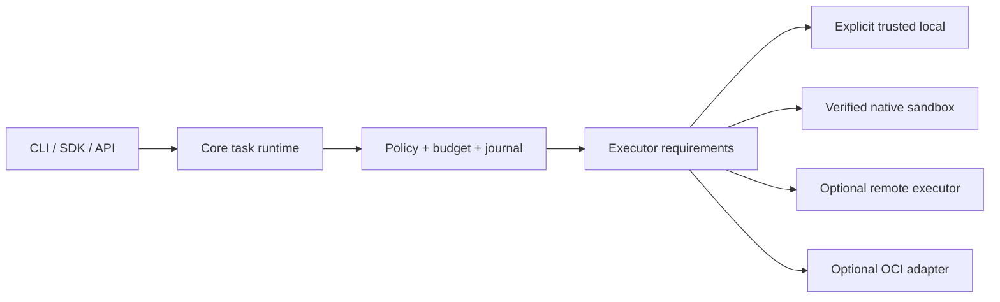

# Технический аудит и план production framework

23 октября 2026. Проверяемая копия: `experimental`, HEAD `8a18fbe837b5c82597f782b6455e96b708607f36`; runtime `78f0df5c2abf18fc4b0035030a92178335134e04`. Разница между ними — документация/validation evidence, без runtime изменений. В начале tracked working tree чистый. Работа этого аудита добавляет только документы и offline probes/evidence.

## Главный вывод

atomic-flow имеет существенную собственную реализацию safety/budget/staging/tools, но пока не подтверждён как production framework. Главный барьер — корректная совместная работа существующих механизмов при конкуренции, сбоях и использовании вне собственного checkout. Ещё один каталог возможностей не заменит проверку этих свойств.

Обнаружены новые дефекты, включая потерю параллельной публикации, конфликт записи индекса, ошибку чтения OpenRouter usage и HTTP 500 на некорректном входе. Старые R01–R07 не объявляются открытыми заново: пакет 17 исправляет конкретные ранее найденные regressions. Его сохранённый CI подтверждает 792 CPU passed / 11 skipped, 17 extra и 26 execution acceptance checks (10 реальных Docker), но не закрывает нынешние находки. Это сохранённое exact-source evidence, не новый CI-запуск данного аудита.

«Абсолютный уровень» не является проверяемым статусом. Рабочая цель — чёткий поддерживаемый scope, измеримые гарантии, честное ограничение failure model и независимая проверка качества. Рекомендуемый первый scope: single-owner Python coding framework, CLI/SDK и single-process authenticated API; Docker-free клиент; serializable writes одного проекта; несколько разрешённых provider routes; поддерживаемые целевые окружения. Multi-tenant/distributed service и writable parallel agents — отдельные этапы после этих гарантий.

## Что и насколько проверили

Три субагента работали параллельно: runtime/state/security, execution/Docker/release, quality/scale/API; основной агент проверял providers, внешние references и объединял выводы. После usage-limit interruption все три направления перезапущены, результаты сохранены. Использован максимум доступных одновременно слотов: основной агент + три субагента.

Покрыты основные подсистемы: источник/changeset/publication, task/session/budget recovery, execution/jobs/remote, index/retrieval, API/SDK, integration composition, evaluation, configuration/packaging/CI и providers. Это системный риск-аудит с чтением критических путей, а не построчная сертификация каждого файла. Project index — карта из 536 tracked/new файлов и 209 Python-файлов в snapshot; это не число вручную проверенных файлов.

Доказательства разделены:

- **Reproduced:** детерминированные offline interleavings publication и index save; API validation; numeric usage; Retry-After; journal validation counts и capability signatures.
- **Static:** OS isolation/process cleanup, fsync/crash guarantees, environment provisioning, storage caps, release workflow, limits текущих integrations.
- **Unmeasured:** live edit quality, реальные provider accounts/native tool compatibility, нагрузочные p95/RSS, native sandbox equivalence, внешний service deployment.

Model calls=0. Ни Docker Desktop, ни новые зависимости не устанавливались. Полные test suites не повторялись. UI/UX вне scope.

Подробности и file:line: [runtime](runtime-audit.md), [execution/release](docker-release-audit.md), [quality/scale/API](quality-scale-audit.md), [provider routing](provider-routing.md). Скрипты и JSON находятся рядом. Findings в этих документах не следует суммировать как независимые дефекты, если они описывают одну проблему композиции.

## Приоритетные барьеры

| Приоритет | Барьер | Что уже защищено | Что ещё требуется |
|---|---|---|---|
| P1, reproduced | Два writer одного root могут оба получить published и затереть друг друга (RT-01). | Hash freshness, per-task lease, journals и rollback. | Project mutation lease вокруг полного publication/recovery; единый протокол для direct edits/rewind. Отдельный контракт внешних редакторов — advisory lock их не блокирует. |
| P1, reproduced | Общее имя tree.json.tmp даёт collision при двух незалоченных save_tree. | Atomic replace против частично записанного target; orchestration lock в отдельных callers. | Уникальные temp files плюс generation/lock для всех writer paths, включая CLI/tools. |
| P1 для durable эксплуатации | Unknown charge/effect блокирует продолжение без поддерживаемого host reconciliation (RT-02). | Fail-closed и отсутствие автоматического replay — это правильная защита. | Evidence-backed, идемпотентный reconcile с согласованием task/session/ledger. Успешный текст модели не снимает hold. |
| P1 для provider ecosystem, reproduced | OpenRouter numeric usage.cost ломает adapter; автоматического failover нет (B01/B02/B05). | Бюджеты и unknown holds на текущем single-backend пути. | Нормализация usage и отдельный attempt coordinator с ценами/контекстом выбранного route. |
| P1 для публичного API, reproduced | 50 001 chars в chat приводит к 500; untyped parts и aggregate body не имеют достаточного admission. | Auth/root checks/concurrency cap уже есть. | Typed request schemas, лимит body до materialization, правильные 4xx, одинаковый контракт endpoint paths. |
| P1 для запуска чужого кода | Local execution не sandbox; Windows parent success/unchecked taskkill не доказывает cleanup. | Docker ограничения и host-owned fixed commands; отдельный unknown state. | Explicit trusted-local и реальный lifecycle handle; untrusted checks только в executor, доказавшем требуемую изоляцию. |
| P1 для framework release | CI проверяет checkout, нет самостоятельной wheel/cross-platform acceptance; зависимости плавают. | Сохранены source hashes и Docker CI artifacts. | Clean installed package tests вне checkout, tested constraints/lock, support matrix, release provenance, обновления/migrations. |
| P1 для практической полезности | Не проверены реальные multi-repo edit tasks; target dependencies не provisioned. | Fixture retrieval, scripted tests, historical calibration/read-only pilot. | Зафиксированные целевые окружения и независимые hidden requirement/regression tests. |
| P2 / G03 | Capabilities SDK/Orchestrator не доходят штатно до TaskRunner; real LSP/MCP/provider compatibility не принята. | Отдельные bounded implementations и protocol fixtures. | Общий host capability contract с перепривязкой к staging; реальные pinned integrations в полном task journey. |
| P2 | Snapshot/index/storage масштабируются недостаточно предсказуемо: полные reads, O(N²) journal append, terminal job caps. | Есть отдельные hard caps/retention, bounded transport output. | Preflight file/byte/disk quotas, streaming copy/hash/cancel, incremental durable journal, GC с recovery tombstones, нагрузочные измерения. |
| P2 | Power-loss durability не установлена; state lifecycle неодинаков у task/session/job. | Process/exception recovery и часть fsync paths. | Явно выбрать supported crash model; write-ahead flush ordering и fault injection для выбранных ОС/FS. |
| P2 для service scale | API run handles/slots process-local. | Подходит для одного процесса владельца. | Сначала enforce/document single-process scope. Shared admission/ownership/event store нужен только перед distributed/multi-worker claim. |

P1 — первый порядок устранения для соответствующего production claim. Static gaps не называются подтверждёнными exploits. Многочисленные safeguards сохраняются: staged publication, approvals, known/unknown cost, root confinement, private execution inputs, output redaction, installed checker bootstrap, общий parent/worker budget и no-replay uncertainty.

## Docker: целевая техническая схема

Docker убрать из обязательного пути клиента и установки ядра. Он уже не является базовой Python dependency, но execution path по умолчанию от него зависит. Цель — не требовать Docker для import, CLI/SDK startup, индекса, поиска, модели, planning и source-only edits.

Executor выбирается по enforced capabilities: filesystem/network/process/IPC restrictions, resource bounds, owned cleanup, runtime/environment identity. Отсутствующая capability ведёт к отказу до запуска. Нельзя тихо превращать `sandbox_required` в local.

- **Сразу:** Docker-free core + проверенное доверенное локальное окружение + optional remote; Docker оставить в CI и/или на remote host. На клиенте не требуется VM.
- **Linux:** daemon-free executor на namespaces/bubblewrap, resource ownership, seccomp; Landlock как дополнительный слой с ABI detection. Нужен собственный проверенный policy profile.
- **Windows:** Job Objects для жизненного цикла процессов; AppContainer/ACL/capabilities — отдельная задача для файловой/сетевой изоляции. Job Object сам по себе не sandbox.
- **macOS:** feasibility signed helper/App Sandbox; не обещать переносимость одной shell-командой.

Native executors не реализуются сразу втроём. Сначала общий contract + одна принятая реализация; остальные явно unsupported для untrusted execution до проверки. Podman вместо Docker не устраняет саму потребность в Linux VM на desktop. Worktree/venv/очищенные env не являются изоляцией от host files/network.

При source-only режиме с отсутствующим обязательным executor нельзя выдавать `tests passed` или автоматически публиковать task, для которой проверка необходима. Предварительная техническая проверка доступности executor должна идти до дорогостоящего model run. Управление окружением target repo, включая install/build hooks, проходит тот же trust/isolation contract.

Первичные OS sources и конкретные строки кода — в [execution/release audit](docker-release-audit.md).

## Провайдеры: что включить

Базовая последовательность: исправить usage/error contracts → route selection → per-attempt accounting → shared quota/cooldown → opt-in live integration → quality evaluation. Подробный контракт и первоисточники — [provider-routing.md](provider-routing.md).

Предлагаемые режимы:

- `free_only`: только явно подтверждённые бесплатные eligible routes, никакого автоматического paid fallback; исчерпание всех квот даёт waiting/pause с reset information.
- `capped_paid`: сначала выбранные free/cheap routes, затем разрешённая платная модель в общем бюджете. Более дорогой route допускается до отправки, после новой reservation.
- `fixed`: одна pinned model/provider для reproducible evaluation и чувствительных задач.

Первая проверяемая группа: Groq + Gemini API + OpenRouter, затем Mistral; exact models по доступности аккаунта и coding/tool tests. Внешний Claude Code Router/LiteLLM — необязательные adapters, не новый обязательный service. Встроенный router сохраняет один контроль расходов и попыток.

Смена разрешённого сервиса после подтверждённого quota refusal допустима. Timeout после send/unknown charge нельзя превращать в бесплатную попытку другого backend. У каждой физической попытки свой ID/usage; один logical turn может содержать несколько attempts. Required tool protocol, context window, pricing и privacy/egress проверяются заново. Неизвестная доступность/стоимость не считается бесплатной. Несколько ключей одного project не дают независимую квоту.

Источники подтверждают ограничения, а не безлимит: [Groq limits](https://console.groq.com/docs/rate-limits), [Gemini project quotas](https://ai.google.dev/gemini-api/docs/rate-limits), [OpenRouter limits](https://openrouter.ai/docs/api_reference/limits). Account-specific capacity/live compatibility пока не проверялись.

## План работ с зависимостями и критериями выхода

Все W1–W9 ниже — **предложенные будущие работы**, не выполненные пакеты реализации. Выбранный порядок начинает с дефектов данных и формирует измеримые gates, а не требует нового UI.

| Шаг | Изменение | Проверяемый выход | Зависимость |
|---|---|---|---|
| W1. Корректность записи | Общий root mutation protocol; уникальные index tmp; сериализация publish/rollback/rewind/direct edit; API schema limits; numeric usage + Retry-After fixes. | Каждый repro превращён в regression; две конкурентные публикации не теряют успешные версии; invalid API input → 4xx без model calls; numeric usage сохраняется. Windows/Linux multiprocess checks, не только scheduling monkeypatch. | Начать первым; блоки source/API/provider можно делать параллельно с чётким владением файлами. |
| W2. Восстановление | Typed state transitions и host reconciliation; единый call/effect/settlement identity; выбранный crash model и durable persistence ordering. | Отказ при unknown; evidence-backed resolve; повторная reconciliation идемпотентна; ни provider, ни tool не replayed; crash между store boundaries восстановим. | W1 source protocol; data contracts согласовать с W3. |
| W3. Routing | Provider adapters + attempt coordinator, quota scope/state, cooldown, free_only/capped_paid, quality/capability/egress allowlists. | Offline fault matrix PASS; один владелец retry; все attempts в общем ledger; zero paid sends в free_only; unknown не retry; no quota reset stampede; отдельный opt-in live smoke. | W1 usage/error fixes + W2 state invariants. |
| W4. Docker-free execution | Executor interface/capability negotiation, trusted local lifecycle, target environment manifest, optional remote; OCI сохраняется adapter. | Ядро ставится/работает без Docker; отсутствующая изоляция не downgraded; descendants cleanup/uncertainty проверены; real target dependencies привязаны к environment digest. | Контракты можно проектировать параллельно W1/W2, реализация на общих state invariants. |
| W5. Release foundation | Wheel/sdist, clean install outside checkout, constraints/support matrix, core/API/worker extras, lint/types и migration fixtures. | CI подтверждает именно site-packages; ни src/tests/PYTHONPATH не подменяют пакет; import/CLI/SDK/API/resources/worker smoke на заявленных ОС/Python. Checksums/SBOM/source provenance. | Можно начинать параллельно W1; обязательно до live benchmark масштабирования. |
| W6. Composition | Один durable TaskRunner capability context; binding к staged workspace; реальные pinned LSP/MCP fixtures; одинаковые safety events во всех entrypoints. | Full task: plan→review→edit→checker→publish, cancel/conflict/recover, notebook source edit, LSP change и MCP read; общий budget/lease/effect gates без private method patching. | W2/W4/W5; не расширять до write-workers. |
| W7. Scale/operations | File/byte/disk preflight, bounded hash/copy/cancel; journal incremental append; safe retention; technical metrics/error taxonomy. | Small/medium/large pinned repo measurements, long session soak, max supported workload; cold/warm index, append p95, RSS, disk, queue/cancel latency опубликованы. Нагрузка ограничена configured caps до OOM. | W1/W2 storage correctness; независимые probes можно раньше. |
| W8. Доказательство полезности | Stage 4: 30 независимых задач из 5 Python repos, holdout by repository, pinned base SHAs/environments и fixed model; baseline vs atomic. | Base FAIL / gold PASS / plausible wrong FAIL calibration; hidden requirement + regression tests; all failures/unknowns/interventions/costs сохранены. Это exploratory pilot, не широкое превосходство. | W5/W6, один принятый executor и опционально W3 fixed mode. |
| W9. Release candidate | Поддерживаемая OS/backend matrix; release rehearsal, migration/crash/soak/security regression, independent adversarial review и consumer verification. | Все обязательные gates закрыты evidence manifest для exact wheel/source/config; open limits опубликованы; pilot users выполняют supported journeys без ручной подмены internals. | W1–W8 для заявленного scope. Непринятые optional adapters не объявляются supported. |

W1 не требует paid calls. Для W8 сначала собирается весь корпус/runner/calibration локально; actual model run выполняется только в явно разрешённых аккаунтах с заданным общим бюджетом. Не расходовать квоты на полный combinatorial benchmark до рабочего baseline.

## Как измерять «максимальный уровень»

Не задаём произвольные достигнутые p95/проценты. До измерений фиксируем workload, hardware, допустимые SLO и acceptance policy. Для release обязательны: отсутствие известных data-loss/scope/secret-leak regressions; отсутствие false pass при missing/zero tests; recoverability в заявленном crash model; installability; bounded resources. Один обнаруженный scope violation не компенсируется хорошим средним success.

Основная quality метрика — независимое полное выполнение требования без regression. Вспомогательные: false-success, ручные исправления, стоимость на успешную задачу с расходами неуспехов, tokens/calls, median/p95 wall time, cancellation latency, peak RSS/disk. Бесплатные tokens имеют нулевой invoice только при подтверждённом tier; token-equivalent valuation отмечать отдельно.

После exploratory pilot выбрать одну confirmation hypothesis и заранее её зафиксировать: например, не хуже baseline более чем на 5 п.п. success при ≥20% меньшей cost per verified success, либо ≥5 п.п. выше success при сопоставимых caps. Эти значения — предложенные project targets из COMPETITIVE_ACCEPTANCE, не отраслевые нормы и не достигнутые результаты. Размер confirmation experiment рассчитывается по pilot и clustered paired intervals; 30 задач не дают автоматической статистической силы.

Затем ablation по одному: graph retrieval → critic → compaction → workers → routing. Если механизм не улучшает verified success/стоимость/latency, упрощать его или оставлять opt-in. Крупные модули делить по этим реальным ownership boundaries (state, attempts, capabilities, execution), а не переписывать проект ради числа строк.

## Учёт Claude Code reference

В проекте найдена именно прежняя ссылка [777genius/claude-code-source-code-full](https://github.com/777genius/claude-code-source-code-full). Проверены LICENSE/architecture docs. Зеркало не аутентифицировано как актуальный официальный source; LICENSE запрещает трактовать его как открыто лицензированный код. Действующий AGENTS.md запрещает импорт его кода/prompts. Используется как список общих вопросов к архитектуре, вместе с предыдущим independent implementation review, без копирования/запуска источника.

Полезные для нашего roadmap темы: единый tool contract, context admission, interruption/resume, concurrency metadata, bounded history, lazy optional modules. Большинство уже представлены scoped implementations; сейчас важнее композиция, измерения и правильные state transitions. Внешнее зеркало не может доказать качество atomic-flow или заменить independent tests. UI, marketplace и расширение списка функций отложены согласно запросу.

## Первый практический набор после утверждения направления

Начать с W1: publication lost update + index race + API validation + provider usage/retry contracts, каждый с regression и focused соседними проверками. Одновременно сделать clean-wheel pipeline W5 и спецификации W2/W4. После этого — reconciliation и provider coordinator, затем полные integration journeys и Stage 4. Не включать новый fallback и не менять execution default до закрытия их accounting/isolation gates.

Сам аудит завершает анализ/план. Production defects здесь обнаружены и описаны, **runtime исправления ещё не внесены**.
